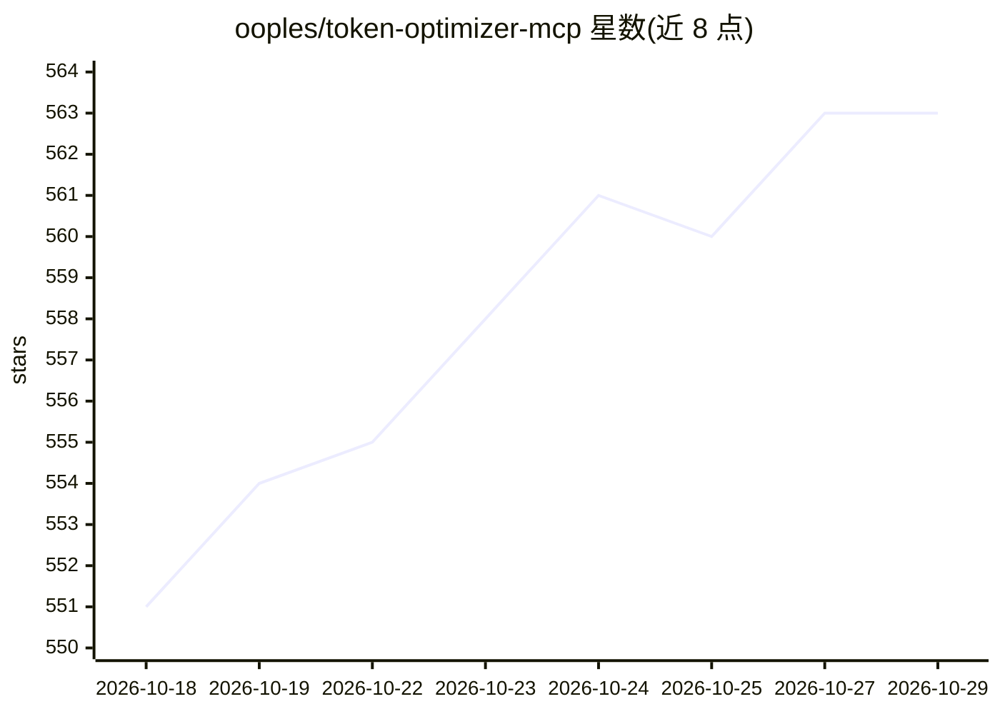

# ooples/token-optimizer-mcp

⭐ 563 · JavaScript · MIT · 推送 2026-10-28 · [GitHub](https://github.com/ooples/token-optimizer-mcp) · 组织维护

**为 AI 编程代理压缩上下文并核算 token 账单的 MCP 服务器**

面向 16 种 CLI 编程客户端的 MCP 服务器：通过块压缩引擎与代理模式压缩请求载荷，按 provider 的缓存计价规则（缓存前缀 0.1x、重写 1.25x）优化 token 费用而非字节量；提供本地账本记录各 agent 的净节省与图谱开销，附可在两个独立测试框架上复现的基准表格（与 HeadRoom 的实现对比，含逐行数字与复现命令）。要求 Node.js 22+，遥测默认关闭，MIT 许可。README 大量篇幅为基准数据与计价方法的详细记录。

## 筛选速览

| 维度 | 判定 | 备注 |
|---|---|---|
| AI 角色 | `ai-ecosystem` | LLM/agent 周边工具 |
| 许可风险 | `permissive` | MIT |
| 部署形态 | `library` | 以包/库形式分发 |
| 模型依赖 | — | README 未给出锁定关系 |
| 硬件要求 | — | 无带数字的原话,不猜 |
| 安装摩擦 | `medium` | 含编译或系统依赖之一 |
| 成熟度 | — | 结构信号不足 |

## 能力要点

- 按 provider 缓存计价规则优化 token 账单而非字节数
- 基准结果可由 committed fixture 与脚本重新推导核验
- 支持 16 种 CLI 客户端，本地账本按 agent 归因净节省
- 块引擎与代理两种模式：标记可用既有 Read 工具还原，无需注入额外检索工具

## 适用场景

- 降低 Claude Code 等 CLI 编程代理的 token 费用
- 在多 agent 环境中统一审计各客户端的压缩节省
- 对比不同压缩策略在缓存前缀计价下的实际成本

## 场景标签

 · 领域:LLM 基础设施/MCP

## 证据(README 行号)

> L5:  Token Optimizer MCP
> L16:  16 clients
> L23:  One local ledger for optimizer tools, live-graph substitutions, every agent, and the graph's own cost.

## 星数曲线

2026-10-18 551 → 2026-10-29 563（+12）

---
*卡片 v1 · prompt 1.4 · 生成 2026-10-21 · 置信度 high · 依据 README sha `d96098087393` · [字段定义](../../DATASET.md)*
