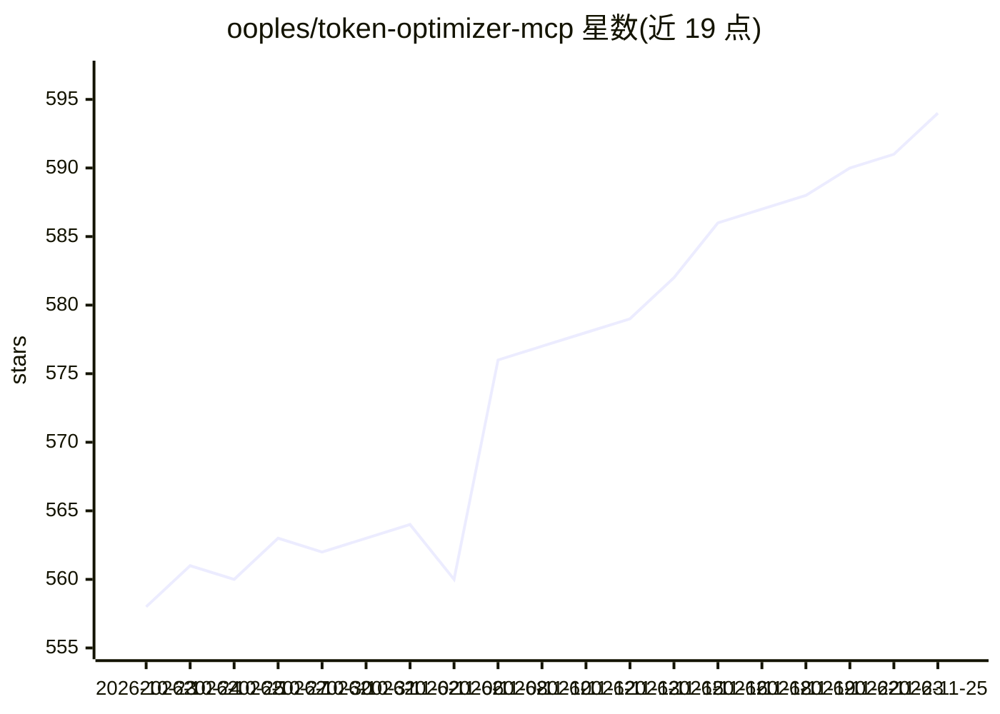

# ooples/token-optimizer-mcp

⭐ 594 · JavaScript · MIT · 推送 2026-11-23 · [GitHub](https://github.com/ooples/token-optimizer-mcp) · [官网](https://www.npmjs.com/package/@ooples/token-optimizer-mcp) · 个人维护

**为 AI 编码代理减少 token 消耗的 hooks/代理/MCP 服务器**

由 hooks、代理和 MCP 服务器三部分组成的本地工具：在 Claude Code 等客户端的内置工具前拦截超大 Read/Grep 调用并改路到缓存化替代，在客户端与提供商之间压缩请求体并保持缓存前缀稳定，提供 smart_read/smart_grep/smart_edit 等工具，并以每项目知识图谱记录会话发现。README 给出 SWE-bench Verified 对照基准（默认模式 0.71× 成本、任务解决数不变）及与多个同类产品的对比数据，包含失败案例。支持 16 个客户端，MIT 许可，需 Node.js 22.18+。

## 筛选速览

| 维度 | 判定 | 备注 |
|---|---|---|
| AI 角色 | `ai-ecosystem` | LLM/agent 周边工具 |
| 许可风险 | `permissive` | MIT |
| 部署形态 | `library` | 以包/库形式分发 |
| 模型依赖 | — | README 未给出锁定关系 |
| 硬件要求 | — | 无带数字的原话,不猜 |
| 安装摩擦 | `low` | 无编译、无系统依赖或容器化 |
| 成熟度 | — | 结构信号不足 |

## 能力要点

- hooks/proxy/MCP 服务器三种机制：拦截大读取、压缩请求体、提供 smart_read 等工具
- 每项目知识图谱在会话间保留发现与决策，携带一条发现约 150 tokens
- 四种模式 assist/enforce/advise/off，可用 TOKEN_OPTIMIZER_MODE 设置
- 支持 16 个客户端，本地运行，遥测默认关闭

## 适用场景

- 降低 Claude Code/Codex 等编码代理的 token 开销
- 让订阅配额在单位 quota 内完成更多工作
- 在会话间保留代理项目的已有发现避免重复推导

## 场景标签

`编码 Agent` `Agent 记忆` · 领域:Agent 开发

## 证据(README 行号)

> L8:  Hooks, a proxy, and an MCP server for Claude Code, Codex, Copilot, Gemini and 12 more clients.
> L193: 1. **Hooks** sit in front of the client's built-in tools. In `enforce` mode a large
> L198: 3. **The MCP server** provides `smart_read`, `smart_grep`, `smart_edit`,

## 星数曲线

2026-10-23 558 → 2026-11-25 594（+36）

---
*卡片 v1 · prompt 1.4 · 生成 2026-11-25 · 置信度 high · 依据 README sha `4ddf79ab36b3` · [字段定义](../../DATASET.md)*
