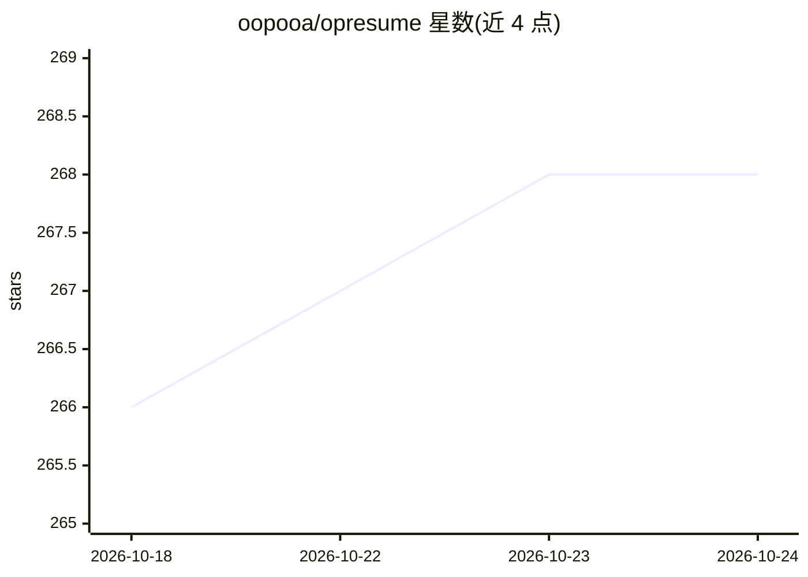

# oopooa/opresume

⭐ 268 · TypeScript · MIT · 推送 2026-10-22 · [GitHub](https://github.com/oopooa/opresume) · [官网](https://opresume.pages.dev) · 个人维护 · 中文 README

**本地运行的简历制作工具，数据仅存浏览器，含 AI 辅助功能**

基于 React 18 + Vite 5 + TypeScript 的在线简历制作工具，数据仅存于浏览器 localStorage，无后端与登录。功能包括滑块式排版控制、4+ 模板切换、8+ 颜色主题、A4 智能分页、Tiptap 富文本编辑、拖拽排序、隐私脱敏模式与 JSON 导入导出，并通过 window.print() 导出 ATS 友好的 PDF。AI 部分：上传 PDF 简历由 AI 自动提取信息、一键 AI 改写内容。需 Node.js >= 18 从源码运行。

## 筛选速览

| 维度 | 判定 | 备注 |
|---|---|---|
| AI 角色 | `ai-enhanced` | 去掉 AI 部分产品仍成立 |
| 许可风险 | `permissive` | MIT |
| 部署形态 | `None` |  |
| 模型依赖 | — | README 未给出锁定关系 |
| 硬件要求 | — | 无带数字的原话,不猜 |
| 安装摩擦 | `low` | 无编译、无系统依赖或容器化 |
| 成熟度 | — | 结构信号不足 |

## 能力要点

- 数据仅存浏览器 localStorage，无后端无登录
- AI 简历导入（PDF 自动提取填充）与 AI 内容一键改写
- 4+ 模板、主题色自定义、智能自动分页
- 隐私脱敏模式一键遮蔽姓名/电话/邮箱等敏感信息

## 适用场景

- 不注册账号、纯本地制作和管理简历
- 把已有 PDF 简历快速导入并迁移到新模板
- 在社区求点评前对简历做隐私脱敏

## 场景标签

`AI 写作` `文档解析` · 领域:内容生成

## 证据(README 行号)

> L3: **No login, beautifully crafted online resume builder** — Data stored locally only, zero leak risk, export anytime
> L26: - **AI Resume Import**: Upload a PDF resume and let AI automatically extract and populate information for quick mig
> L36: - **No login, zero upload**: All data is stored exclusively in the browser's `localStorage` — no backend, no databa

## 星数曲线

2026-10-18 266 → 2026-10-24 268（+2）

---
*卡片 v1 · prompt 1.4 · 生成 2026-10-22 · 置信度 high · 依据 README sha `dd32b0299d6b` · [字段定义](../../DATASET.md)*
