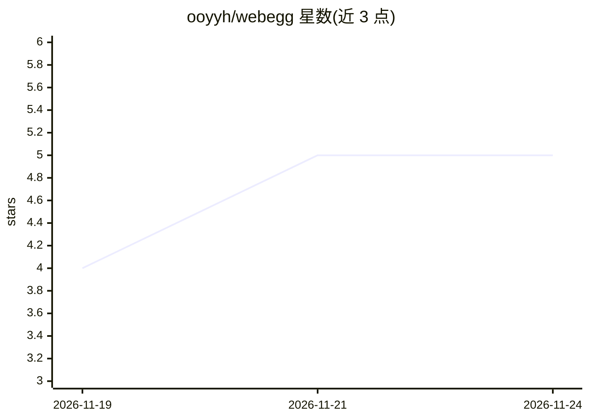

# ooyyh/webegg

⭐ 5 · Go · 推送 2026-11-18 · [GitHub](https://github.com/ooyyh/webegg) · [官网](https://github.com/ooyyh/webegg/releases/latest) · 个人维护 · 中文 README

**本地 AI 控制面：驱动 Gemini 网页端执行 26 项真实编程工具**

基于 Wails + Go + React 与 Manifest V3 浏览器扩展的本地 AI 控制面：通过插件驱动 Gemini 网页对话，把 26 项本地工具（文件读写、目录、glob/grep 搜索、只读 Git、Shell、后台进程、项目脚本）提供给模型调用，结果以结构化卡片渲染在桌面端。写入/删除/Shell/进程可按策略要求本地批准，审批与工具名和参数哈希绑定。不注入 Gemini 页面 UI、不依赖第三方 API Key，数据留在本机。仅支持 Windows x64，扩展需开发者模式加载，Shell 等非操作系统沙箱。

## 筛选速览

| 维度 | 判定 | 备注 |
|---|---|---|
| AI 角色 | `ai-native` | 本体是模型或模型工具 |
| 许可风险 | `none` | — |
| 部署形态 | `desktop` | 安装包/桌面程序 |
| 模型依赖 | — | README 未给出锁定关系 |
| 硬件要求 | — | 无带数字的原话,不猜 |
| 安装摩擦 | `low` | 无编译、无系统依赖或容器化 |
| 成熟度 | — | 结构信号不足 |

## 能力要点

- 26 项本地编程工具：文件、目录、搜索、Git、Shell、后台进程
- 全自动/需批准两种执行策略，审批令牌 5 分钟过期且一次性
- 通过 Manifest V3 扩展驱动 Gemini 网页端，含 alarms 保活与任务租约恢复
- 路径规范化与敏感文件拦截、MCP Bearer Token 认证等本地安全边界

## 适用场景

- 让 Gemini 直接浏览本地项目结构并回答问题
- 自动运行测试并修复失败的用例
- 检查 Git 差异定位 bug 并修改后重新验证
- 启动开发服务器并用后台进程工具查看日志确认监听地址

## 场景标签

`编码 Agent` `浏览器自动化` · 领域:效率与自动化

## 证据(README 行号)

> L10: WebEgg 是一个 **Wails + Go + React + Manifest V3** 的本地 AI 控制面。它通过浏览器插件驱动 Gemini 网页端，在本地执行真实的文件、目录、搜索、Git、Shell 和后台进程工具
> L31: - **26 项真实编程工具**：文件、目录、搜索、Git、Shell、后台进程和项目脚本。
> L32: - **全自动 / 需批准**：读取自动，写入、删除、Shell 和进程可按策略请求本地批准。

## 星数曲线

2026-11-19 4 → 2026-11-24 5（+1）

---
*卡片 v1 · prompt 1.4 · 生成 2026-11-21 · 置信度 high · 依据 README sha `6f321a742862` · [字段定义](../../DATASET.md)*
