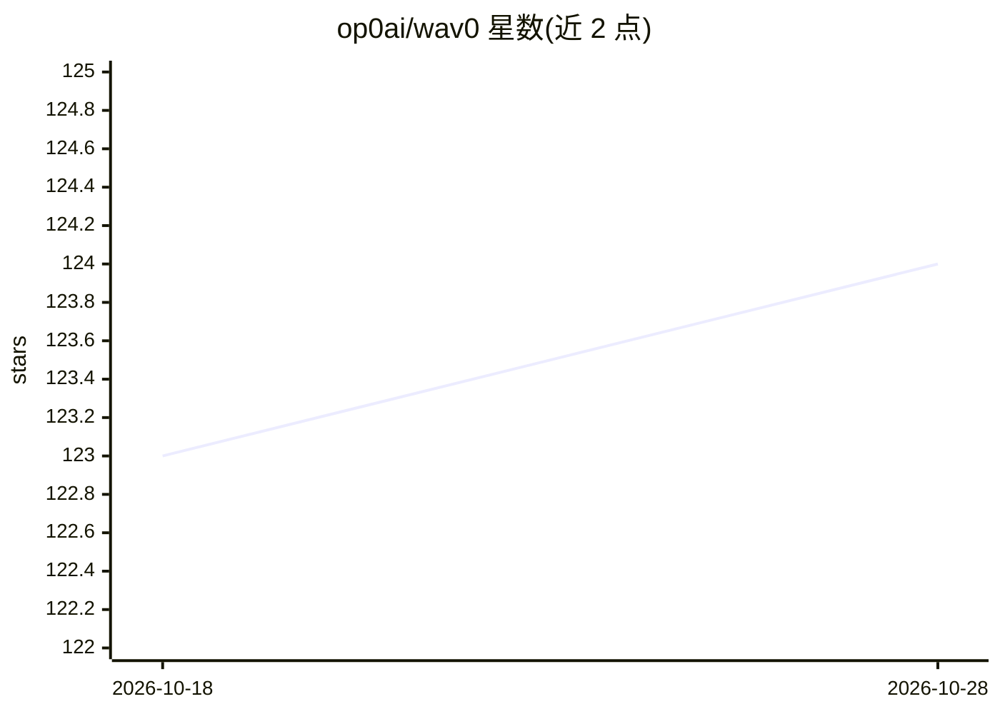

# op0ai/wav0

⭐ 124 · TypeScript · MIT · 推送 2026-10-15 · [GitHub](https://github.com/op0ai/wav0) · [官网](https://wav0.app) · 组织维护

**面向创作者的浏览器端 AI 数字音频工作站（DAW）**

WAV0 是一个运行于浏览器的 AI-Native DAW，面向音乐人、视频/播客创作者、游戏开发者等需要制作与编辑音频的用户：支持声音设计、音频编辑、AI 生成（歌曲、背景音乐、音效）与快速导出，并强调实时协作工作流。无需下载即可在 wav0.app 使用；自托管指南标注为 coming soon。仓库以 MIT 许可开源，招募贡献者参与音频引擎、AI 集成、UI/UX、移动端适配等方向的开发。

## 筛选速览

| 维度 | 判定 | 备注 |
|---|---|---|
| AI 角色 | `ai-enhanced` | 去掉 AI 部分产品仍成立 |
| 许可风险 | `permissive` | MIT |
| 部署形态 | `None` |  |
| 模型依赖 | — | README 未给出锁定关系 |
| 硬件要求 | — | 无带数字的原话,不猜 |
| 安装摩擦 | `low` | 无编译、无系统依赖或容器化 |
| 成熟度 | — | 结构信号不足 |

## 能力要点

- 浏览器内运行，无需下载客户端
- AI Producer 用于生成歌曲、背景音乐与音效
- 实时协作工作流与快速导出
- MIT 许可开源，招募音频引擎/AI 集成等方向贡献者

## 适用场景

- 在浏览器里制作和编辑歌曲、播客、视频音频
- 快速生成背景音乐、音效与片头片尾
- 与协作者实时共同制作音轨

## 场景标签

 · 领域:音频制作/创意工具

## 证据(README 行号)

> L13: > **WAV0 is an AI-Native DAW (Digital Audio Workstation) for Sound Design and Production.** Fast iterations, collab
> L28: - **YouTube Creators**: Generate custom background music, sound effects, and intros in seconds

## 星数曲线

2026-10-18 123 → 2026-10-28 124（+1）

---
*卡片 v1 · prompt 1.4 · 生成 2026-10-23 · 置信度 mid · 依据 README sha `2230339ff55d` · [字段定义](../../DATASET.md)*
