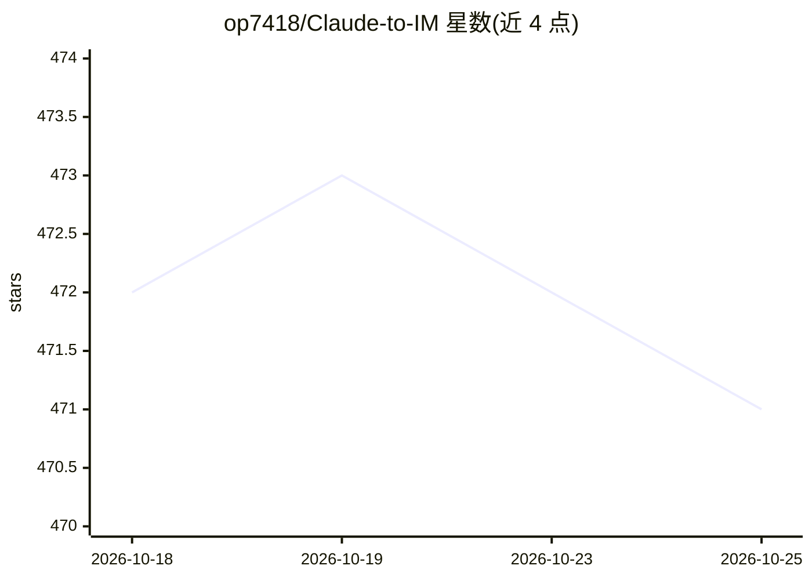

# op7418/Claude-to-IM

⭐ 471 · TypeScript · MIT · 推送 2026-03-23 · [GitHub](https://github.com/op7418/Claude-to-IM) · 个人维护 · 中文 README

**把 Claude Code SDK 接入 Telegram/Discord/飞书的桥接库**

面向 Node.js 开发者的 host-agnostic 桥接库，将 Claude Code SDK 连接到 Telegram、Discord、飞书三个 IM 平台，处理消息路由、流式预览、权限审批按钮、Markdown 渲染、分块重试与限流等 IM 侧逻辑；持久化、LLM 调用与权限解析通过 4 个依赖注入接口交给宿主应用实现。限制：非独立应用，宿主须实现 BridgeStore（约 30 个方法）、LLMProvider（SSE 流须匹配 Claude Code 事件协议）等接口，且需在各平台自行创建 bot 并获取 token。该库从 CodePilot 桌面应用中抽出。

## 筛选速览

| 维度 | 判定 | 备注 |
|---|---|---|
| AI 角色 | `ai-ecosystem` | LLM/agent 周边工具 |
| 许可风险 | `permissive` | MIT |
| 部署形态 | `library` | 以包/库形式分发 |
| 模型依赖 | locked-api |  |
| 硬件要求 | — | 无带数字的原话,不猜 |
| 安装摩擦 | `low` | 无编译、无系统依赖或容器化 |
| 成熟度 | — | 结构信号不足 |

## 能力要点

- Telegram/Discord/飞书三平台适配器，支持流式预览与消息编辑节流
- 工具审批的行内按钮交互（allow/deny/allow for session）
- 令牌桶限流（每会话 20 msg/min）、白名单授权与审计日志
- 4 个 DI 接口解耦宿主依赖，无数据库驱动与框架锁定

## 适用场景

- 把 Claude Code 会话接入 IM 群/频道远程交互
- 在自有 Node.js 应用中嵌入多平台 IM 桥接能力
- 为自己的 Claude Code 客户端增加移动端消息入口

## 场景标签

 · 领域:LLM 基础设施/消息桥接

## 证据(README 行号)

> L5: Claude-to-IM is a host-agnostic bridge library that connects Claude Code SDK to IM platforms, allowing users to inte
> L7: This library handles all IM-side complexity — message routing, streaming previews, permission approval flows, Markdo

## 星数曲线

2026-10-18 472 → 2026-10-25 471（-1）

---
*卡片 v1 · prompt 1.4 · 生成 2026-10-22 · 置信度 high · 依据 README sha `bc3c4c158449` · [字段定义](../../DATASET.md)*
