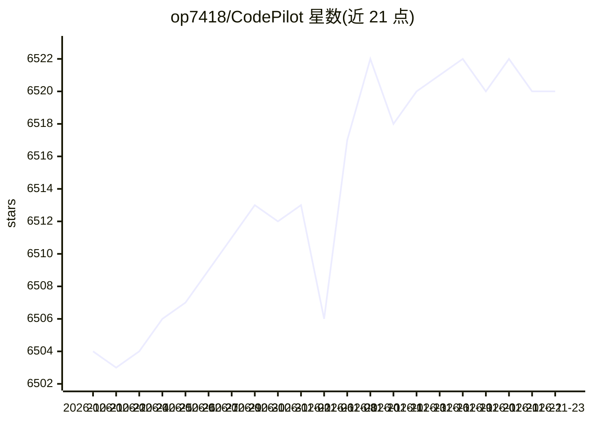

# op7418/CodePilot

⭐ 6,520 · TypeScript · NOASSERTION · 推送 2026-11-22 · [GitHub](https://github.com/op7418/CodePilot) · [官网](https://www.codepilot.sh/) · 个人维护 · 中文 README

**多模型 AI Agent 桌面客户端：接入多家服务商并支持手机远程控制**

基于 Electron + Next.js 的桌面 AI Agent 客户端：内置 17+ 服务商预设（Anthropic、OpenRouter、Bedrock、智谱 GLM、Kimi、Ollama 等），支持会话中途切换模型；通过 MCP 服务器（stdio/sse/http）与 skills.sh 市场扩展能力；含 Assistant Workspace（persona/memory 文件）、生成式 UI、图像生成、cron 任务调度、token 用量统计、Telegram/QQ/微信等 Bridge 远程控制。提供 macOS/Windows/Linux 安装包，亦可从源码构建；Claude Code CLI 为可选增强。许可证为 BSL-1.1。

## 筛选速览

| 维度 | 判定 | 备注 |
|---|---|---|
| AI 角色 | `ai-ecosystem` | LLM/agent 周边工具 |
| 许可风险 | `none` | NOASSERTION |
| 部署形态 | `desktop` | 安装包/桌面程序 |
| 模型依赖 | local-ok | 支持本地模型 |
| 硬件要求 | — | 无带数字的原话,不猜 |
| 安装摩擦 | `low` | 无编译、无系统依赖或容器化 |
| 成熟度 | — | 结构信号不足 |

## 能力要点

- 内置 17+ AI 服务商预设，会话中可切换模型不丢失上下文
- 支持添加 MCP 服务器（stdio/sse/http）并运行时监控
- Assistant Workspace：soul.md/user.md/memory.md 持久记忆
- Bridge 支持经 Telegram/飞书/Discord/QQ/微信远程控制

## 适用场景

- 用一个桌面客户端接入并切换多家 AI 服务商
- 通过 MCP 服务器与自定义技能扩展 AI 助手能力
- 在手机上通过聊天软件远程操控桌面上的 AI 会话

## 场景标签

`AI 助手` `模型网关` · 领域:Agent 开发

## 证据(README 行号)

> L3: **A multi-model AI agent desktop client** -- connect any AI provider, extend with MCP & skills, control from your ph
> L39: Connect to **17+ AI providers** out of the box. Switch providers and models mid-conversation without losing context
> L116: |Providers|17+ providers: Anthropic, OpenRouter, Bedrock, Vertex, Zhipu GLM, Kimi, Moonshot, MiniMax, Volcengine, 

## 星数曲线

2026-10-21 6,504 → 2026-11-23 6,520（+16）

---
*卡片 v1 · prompt 1.4 · 生成 2026-11-23 · 置信度 high · 依据 README sha `ea4c59ff1ef7` · [字段定义](../../DATASET.md)*
