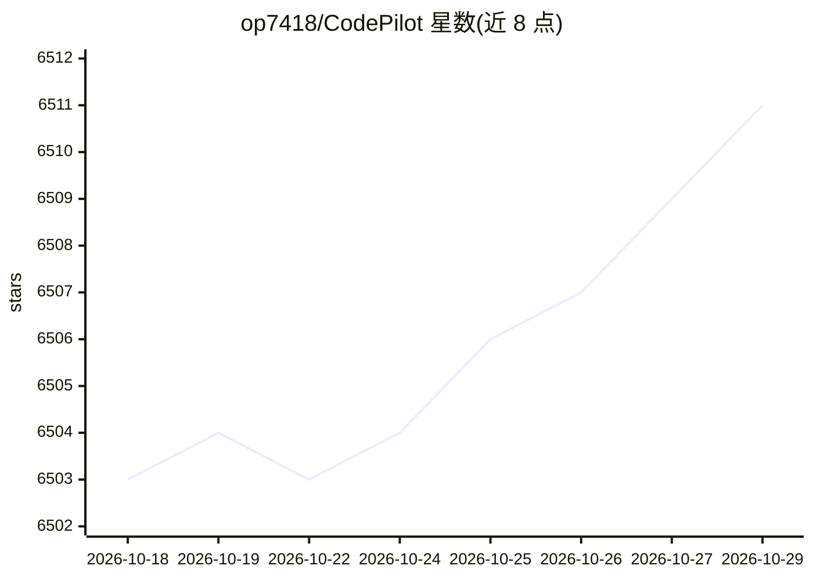

# op7418/CodePilot

⭐ 6,511 · TypeScript · NOASSERTION · 推送 2026-09-22 · [GitHub](https://github.com/op7418/CodePilot) · [官网](https://www.codepilot.sh/) · 个人维护 · 中文 README

**多模型 AI agent 桌面客户端，接入多家 AI 提供商并支持远程控制**

基于 Electron + Next.js 构建的桌面客户端：开箱接入 17+ AI 提供商（Anthropic、OpenRouter、Bedrock、Vertex、智谱 GLM、Kimi、MiniMax、火山方舟、Ollama、LiteLLM 及自定义兼容端点），支持会话内切换模型、MCP 服务器、技能市场、生成式 UI、定时任务与 SQLite 本地存储。可通过 Telegram/飞书/Discord/QQ/微信远程桥接从手机控制。可选安装 Claude Code CLI 解锁文件编辑与终端命令。提供 macOS/Windows/Linux 安装包，采用 BSL-1.1 许可证。

## 筛选速览

| 维度 | 判定 | 备注 |
|---|---|---|
| AI 角色 | `ai-ecosystem` | LLM/agent 周边工具 |
| 许可风险 | `none` | NOASSERTION |
| 部署形态 | `desktop` | 安装包/桌面程序 |
| 模型依赖 | local-ok | 支持本地模型 |
| 硬件要求 | — | 无带数字的原话,不猜 |
| 安装摩擦 | `low` | 无编译、无系统依赖或容器化 |
| 成熟度 | — | 结构信号不足 |

## 能力要点

- 17+ AI 提供商接入，会话中途切换模型不丢失上下文
- MCP 服务器（stdio/sse/http）与 skills.sh 技能市场
- Remote Bridge 支持 Telegram/飞书/Discord/QQ/微信远程控制
- 会话可暂停、恢复并回退到任意检查点

## 适用场景

- 在桌面统一使用多家 AI 提供商的模型进行对话与编码
- 通过手机经即时通讯平台远程控制桌面端 AI 助手
- 借助 MCP 与技能扩展 agent 的可调用能力

## 场景标签

`AI 助手` `编码 Agent` · 领域:编码与开发

## 证据(README 行号)

> L39: Connect to **17+ AI providers** out of the box. Switch providers and models mid-conversation without losing context
> L52: CodePilot started as a coding tool but has grown into a **general-purpose AI agent desktop**:
> L116: |Providers|17+ providers: Anthropic, OpenRouter, Bedrock, Vertex, Zhipu GLM, Kimi, Moonshot, MiniMax, Volcengine, 

## 星数曲线

2026-10-18 6,503 → 2026-10-29 6,511（+8）

---
*卡片 v1 · prompt 1.4 · 生成 2026-10-20 · 置信度 high · 依据 README sha `fa2e799dc233` · [字段定义](../../DATASET.md)*
