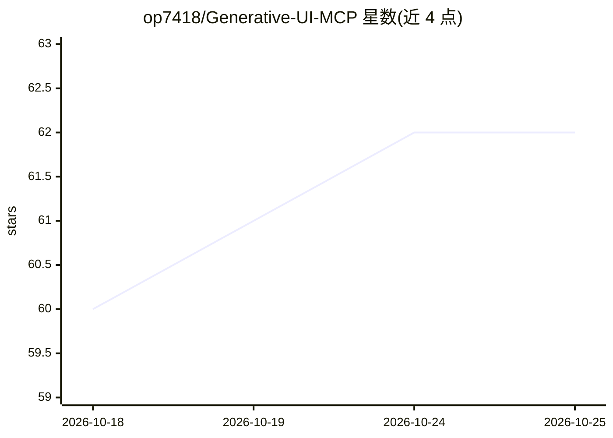

# op7418/Generative-UI-MCP

⭐ 62 · TypeScript · 推送 2026-03-16 · [GitHub](https://github.com/op7418/Generative-UI-MCP) · 个人维护

**为 AI 模型按需提供生成式 UI 设计规范的 MCP 服务器**

一个基于 Model Context Protocol 的 stdio 服务器，向 AI 宿主（Claude Code、Claude Desktop、Cursor、Windsurf 等）按需提供可视化生成的设计规范：模型调用 load_ui_guidelines 工具加载 interactive/chart/mockup/art/diagram 五类模块，获取设计系统、调色板、组件模板、SVG 指南与 8 种图表类型的布局规则。另提供约 300 token 的 system-prompt 资源供宿主注入，避免在每次请求中预置完整规范以节省 token。以 npx 运行，无需本地编译。

## 筛选速览

| 维度 | 判定 | 备注 |
|---|---|---|
| AI 角色 | `ai-ecosystem` | LLM/agent 周边工具 |
| 许可风险 | `none` | — |
| 部署形态 | `library` | 以包/库形式分发 |
| 模型依赖 | — | README 未给出锁定关系 |
| 硬件要求 | — | 无带数字的原话,不猜 |
| 安装摩擦 | `low` | 无编译、无系统依赖或容器化 |
| 成熟度 | — | 结构信号不足 |

## 能力要点

- 单一工具 load_ui_guidelines 支持按模块按需加载设计规范
- 五类模块覆盖交互控件、图表、UI 模拟图、SVG 插画、示意图
- 约 300 token 的可注入 system-prompt 资源，含输出格式与流式规则等硬约束
- 多模块加载时共享章节自动去重

## 适用场景

- 让 Claude/Cursor 等编程助手生成风格一致的可视化组件
- 减少系统提示中预置设计规范造成的 token 消耗
- 生成图表、流程图、SVG 插画等流式安全的交互式小部件

## 场景标签

`提示工程` · 领域:Agent 开发

## 证据(README 行号)

> L3: An MCP server that teaches AI models to generate interactive visualizations — charts, diagrams, mockups, and more.
> L9: Instead of stuffing thousands of tokens of design rules into every system prompt, this MCP server lets the model **l
> L19: The model calls `load_ui_guidelines` with the modules it needs, and gets back comprehensive design specs including:

## 星数曲线

2026-10-18 60 → 2026-10-25 62（+2）

---
*卡片 v1 · prompt 1.4 · 生成 2026-10-24 · 置信度 high · 依据 README sha `894590cc3560` · [字段定义](../../DATASET.md)*
