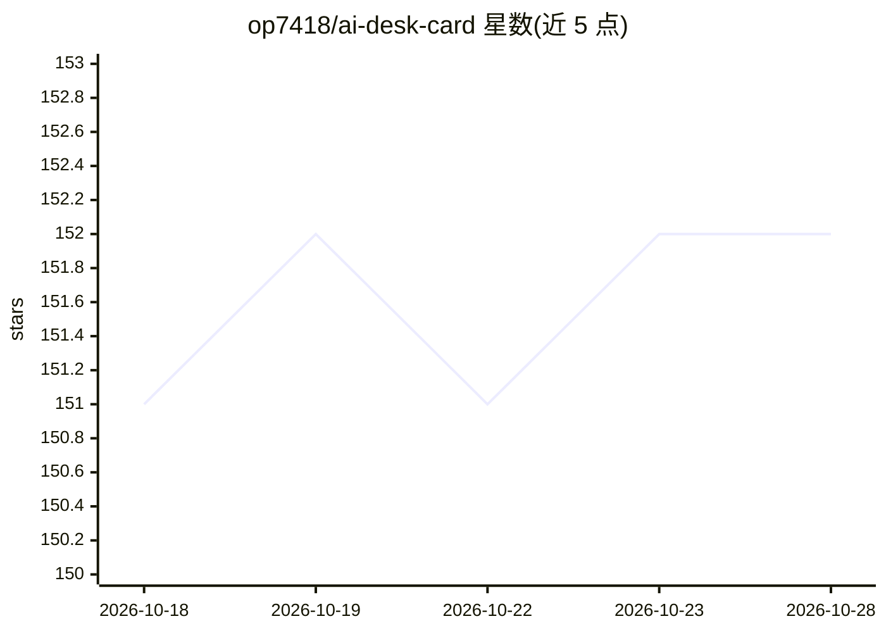

# op7418/ai-desk-card

⭐ 152 · Python · NOASSERTION · 推送 2026-05-22 · [GitHub](https://github.com/op7418/ai-desk-card) · [官网](https://github.com/op7418/ai-desk-card) · 个人维护 · 中文 README

**给 AI Agent 用的墨水屏副屏 Skill：把信息推到 M5Paper**

适配 Claude Code / Codex 等 Agent 的桌面副屏 Skill：将 M5Paper V1.1 4.7 寸墨水屏作为显示器旁的 ambient 副屏，由 Agent 推送 16 种 widget（天气、日程、todo、PR 队列、AI 状态等）。装 Skill 后烧固件、配 Wi-Fi、推送均由 Agent 引导完成。架构为服务端渲染：电脑上的 Python daemon 用 Pillow 渲染像素帧，本地 HTTP 直推，无云依赖。仅支持 M5Paper 系列（其他 ESP32 墨水屏板在 roadmap），Linux 未深度测试，Windows 需 WSL2。

## 筛选速览

| 维度 | 判定 | 备注 |
|---|---|---|
| AI 角色 | `ai-ecosystem` | LLM/agent 周边工具 |
| 许可风险 | `none` | NOASSERTION |
| 部署形态 | `library` | 以包/库形式分发 |
| 模型依赖 | — | README 未给出锁定关系 |
| 硬件要求 | — | 无带数字的原话,不猜 |
| 安装摩擦 | `low` | 无编译、无系统依赖或容器化 |
| 成熟度 | — | 结构信号不足 |

## 能力要点

- 16 种 widget（weather/calendar/pr-queue/ai-status 等），4 槽位 2-1-1 布局
- 服务端渲染：daemon 用 Python+Pillow 渲染帧，固件只负责显示
- 三种供电模式，电池+BLE 待机模式续航约 6 个月
- 本地运行：daemon 绑 127.0.0.1，LAN 直推，无云依赖

## 适用场景

- 给 Claude Code / Codex 等 Agent 配一个物理 ambient 输出屏
- 桌面常显天气、日程、todo、PR 队列等状态
- 监控当前 AI session 与 AI 任务列表

## 场景标签

 · 领域:AI Agent 硬件外设/桌面显示

## 证据(README 行号)

> L12: 一个适配 Claude Code / Codex 等 Agent 的桌面副屏 Skill。把 M5Paper V1.1 4.7 寸墨水屏立在显示器旁边，由 AI Agent 推送 widget：天气、日程、todo、PR 队列、A
> L19: 你 ──说自然语言──▶ AI Agent ──触发──▶ Skill ──自动执行──▶ M5Paper 屏上
> L259: 不必。`SKILL.md` 是 agent-agnostic 入口，任何识别这格式 + 有 shell 权限的 Agent 都能用（Codex / Cursor / Aider / 自写 Agent）。`plugin/` 里的 

## 星数曲线

2026-10-18 151 → 2026-10-28 152（+1）

---
*卡片 v1 · prompt 1.4 · 生成 2026-10-22 · 置信度 high · 依据 README sha `bd5e60adeabc` · [字段定义](../../DATASET.md)*
