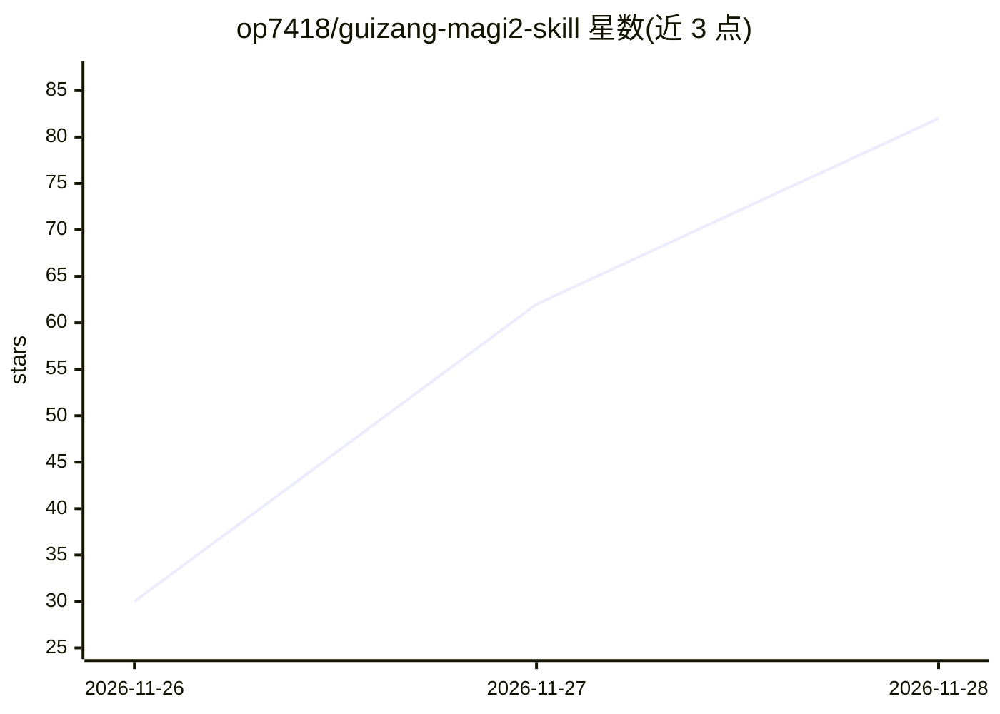

# op7418/guizang-magi2-skill

⭐ 82 · Python · AGPL-3.0 · 推送 2026-11-25 · [GitHub](https://github.com/op7418/guizang-magi2-skill) · 个人维护 · 中文 README

**给 AI 助手装的视频生成工作流 Skill：视频转代码官网与代码控视频**

打包了 Video to Code 与 Code to Video 两套工作流的 Agent Skill，供 Antigravity、Claude Code、Codex 等带终端权限的 AI 助手读取执行。内容包含 MAGI-2 八条提示词优化规则与模板、LibTV MCP 接入与 Antigravity 一键修复脚本、灰盒预处理脚本（静音/抽帧体检/对比视频合成）及贴纸描边脚本。需 LibTV 账号调用视频与图像生成接口，依赖 Node.js 18+、Python 3.9+ 与 ffmpeg，不支持纯离线环境。AGPL-3.0 许可。

## 筛选速览

| 维度 | 判定 | 备注 |
|---|---|---|
| AI 角色 | `ai-ecosystem` | LLM/agent 周边工具 |
| 许可风险 | `viral` | AGPL-3.0 |
| 部署形态 | `library` | 以包/库形式分发 |
| 模型依赖 | — | README 未给出锁定关系 |
| 硬件要求 | — | 无带数字的原话,不猜 |
| 安装摩擦 | `medium` | 含编译或系统依赖之一 |
| 成熟度 | — | 结构信号不足 |

## 能力要点

- Video to Code：参照生成视频写出一镜到底滚动交互网页
- Code to Video：代码灰盒预演动作后交 MAGI-2 重绘成片
- 内置 MAGI-2 八条提示词规则与 4 套填空模板
- 含 Antigravity 版 LibTV MCP 一键安装/修复脚本

## 适用场景

- 给新品做带视差动效的一镜到底发布页
- 制作动作卡点精准的风格化动画短片或游戏 PV
- 生成带清晰中文印刷字的商业快剪视频
- 在 AI 助手里把 LibTV 当日常视觉素材工厂调用

## 场景标签

`视频生成` `提示工程` · 领域:Agent 开发

## 证据(README 行号)

> L9: Agent Skill
> L30: 我把跑通这两套玩法的完整流程、踩坑总结出来的 **MAGI-2 提示词优化规则**，以及 **Antigravity 版 LibTV MCP 一键修复脚本** 全部打包进了这个 Skill。装上就能直接让你的 AI 照着做。
> L128: |`SKILL.md`|AI 读取的主入口：流程判断、提示词硬规则、MCP 防坑铁律与验收表|

## 星数曲线

2026-11-26 30 → 2026-11-28 82（+52）

---
*卡片 v1 · prompt 1.4 · 生成 2026-11-26 · 置信度 high · 依据 README sha `50d4bfa6273c` · [字段定义](../../DATASET.md)*
