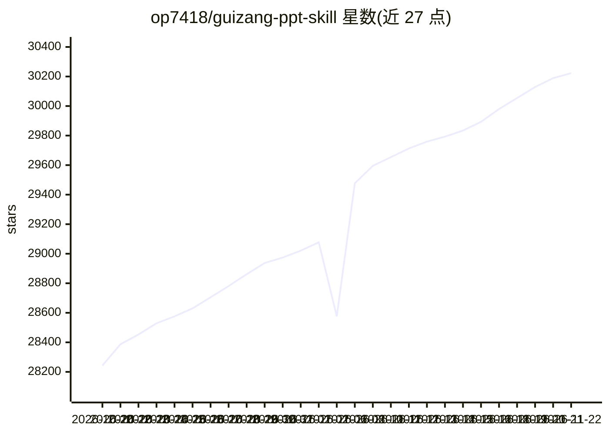

# op7418/guizang-ppt-skill

⭐ 30,223 · HTML · AGPL-3.0 · 推送 2026-10-30 · [GitHub](https://github.com/op7418/guizang-ppt-skill) · 个人维护 · 中文 README

**给 Claude Code/Codex 等 Agent 的网页 PPT 生成技能**

适配 Claude Code / Codex 等 Agent 环境的 Skill，用户以自然语言触发后由 Agent 生成单文件 HTML 横向翻页 PPT、PPT 配图与多平台封面。内置电子杂志风与瑞士国际主义两套视觉系统（分别提供 10 种与 22 种锁定版式）、主题色预设与品牌色收束脚本、演讲者模式（双窗口观众屏、备注、计时排练、故障恢复）以及低性能静态模式。交付为无需构建与服务器的单文件 HTML；瑞士风与演讲模式提供 Node 校验脚本，可用 Playwright 做渲染后量化检查。不导出 PPTX，不适合多人协作编辑场景。

## 筛选速览

| 维度 | 判定 | 备注 |
|---|---|---|
| AI 角色 | `ai-native` | 本体是模型或模型工具 |
| 许可风险 | `viral` | AGPL-3.0 |
| 部署形态 | `library` | 以包/库形式分发 |
| 模型依赖 | — | README 未给出锁定关系 |
| 硬件要求 | — | 无带数字的原话,不猜 |
| 安装摩擦 | `low` | 无编译、无系统依赖或容器化 |
| 成熟度 | — | 结构信号不足 |

## 动量与使用信号

- 维护:`active` — 距上次 push 72.2 天,年发版 1,2 位贡献者
- 涨星:近 1 天 **+72**(自 20261016 起算)
- 安装:npm 包 `skills` 月下载 23,786,800

## 能力要点

- 两套视觉系统：电子杂志风 10 种布局、瑞士风 22 个具名锁定版式
- Codex 中可调用 GPT-Image 2.0 / GPT-M 2.0 生成配图并按槽位比例插入
- 演讲者模式：双窗口观众屏、结构化备注、计时排练与现场故障恢复，全本地运行
- 脚本校验版式与对比度（WCAG + APCA），单文件 HTML 无需构建或服务器

## 适用场景

- 把长文章或 Markdown 变成演讲用网页 PPT
- 从同一份内容生成公众号、小红书、视频号等多平台封面
- 线下分享时用演讲者模式排练并控制时长
- 把产品截图重新设计成统一风格的 PPT 配图

## 场景标签

`图像生成` · 领域:内容生成

## 证据(README 行号)

> L16: 一个适配 Claude Code / Codex 等 Agent 环境的网页 PPT 技能,用于生成**单文件 HTML 横向翻页 PPT**、PPT 配图和多平台封面,并内置完整的排练与演讲者模式。
> L100: **✅ 合适**:线下分享 / 行业内部讲话 / 私享会 / AI 产品发布 / demo day / 带强烈个人风格的演讲

## 星数曲线

2026-10-20 28,243 → 2026-11-22 30,223（+1,980）

---
*卡片 v1 · prompt 1.4 · 生成 2026-11-22 · 置信度 high · 依据 README sha `146ef3323e4b` · [字段定义](../../DATASET.md)*
