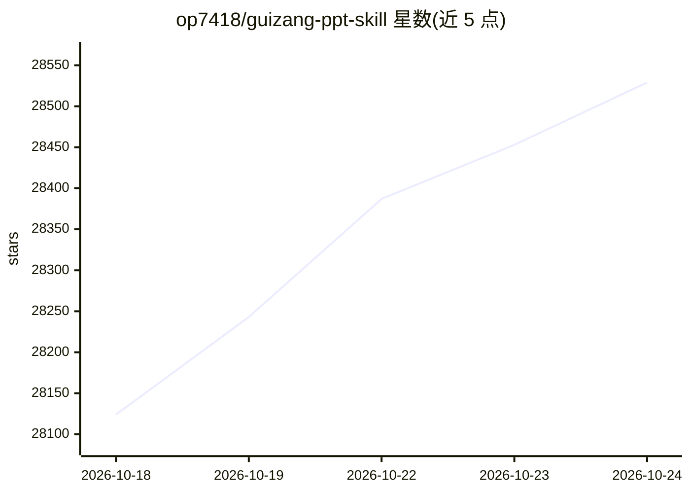

# op7418/guizang-ppt-skill

⭐ 28,576 · HTML · AGPL-3.0 · 推送 2026-08-07 · [GitHub](https://github.com/op7418/guizang-ppt-skill) · 个人维护 · 中文 README

**给 AI Agent 用的网页 PPT 生成技能：产出单文件 HTML 演示**

适配 Claude Code / Codex 等 Agent 环境的 Skill，生成单文件 HTML 横向翻页 PPT、配图与多平台封面。内置两套视觉系统：电子杂志风（10 种布局）与瑞士国际主义风（22 种锁定版式、4 套锚点色），含主题色预设并禁止自定义 hex。提供配图流程、演讲者模式（双窗口观众屏、备注、计时、排练）与脚本校验器。输出为无需构建与服务器、浏览器直接打开的单文件 HTML，不支持导出 PPTX。

## 筛选速览

| 维度 | 判定 | 备注 |
|---|---|---|
| AI 角色 | `ai-native` | 本体是模型或模型工具 |
| 许可风险 | `viral` | AGPL-3.0 |
| 部署形态 | `library` | 以包/库形式分发 |
| 模型依赖 | — | README 未给出锁定关系 |
| 硬件要求 | — | 无带数字的原话,不猜 |
| 安装摩擦 | `low` | 无编译、无系统依赖或容器化 |
| 成熟度 | — | 结构信号不足 |

## 动量与使用信号

- 维护:`active` — 距上次 push 72.2 天,年发版 1,2 位贡献者
- 涨星:近 1 天 **+72**(自 20261016 起算)
- 安装:npm 包 `skills` 月下载 23,786,800

## 能力要点

- 双视觉系统：电子杂志风 10 种布局 + 瑞士风 22 种锁定版式
- 演讲者模式：双窗口观众屏、备注、计时排练、激光笔与故障恢复
- Codex 中可用 GPT-Image 生成配图与多平台封面
- 单文件 HTML 交付，按 B 键可退回低性能静态模式

## 适用场景

- 把长文章或 Markdown 转成演讲 PPT
- 生成公众号/小红书等多平台封面图
- 线下分享现场用演讲者模式排练与放映
- 产品截图统一风格后再设计为 PPT 配图

## 场景标签

`图像生成` · 领域:内容生成

## 证据(README 行号)

> L16: 一个适配 Claude Code / Codex 等 Agent 环境的网页 PPT 技能,用于生成**单文件 HTML 横向翻页 PPT**、PPT 配图和多平台封面,并内置完整的排练与演讲者模式。
> L128: |Claude Code|支持|原生 Skill 工作流,适合生成和迭代 HTML deck|

## 星数曲线

2026-10-18 28,124 → 2026-10-24 28,529（+405）

---
*卡片 v1 · prompt 1.4 · 生成 2026-10-18 · 置信度 high · 依据 README sha `89fe830f52ca` · [字段定义](../../DATASET.md)*
