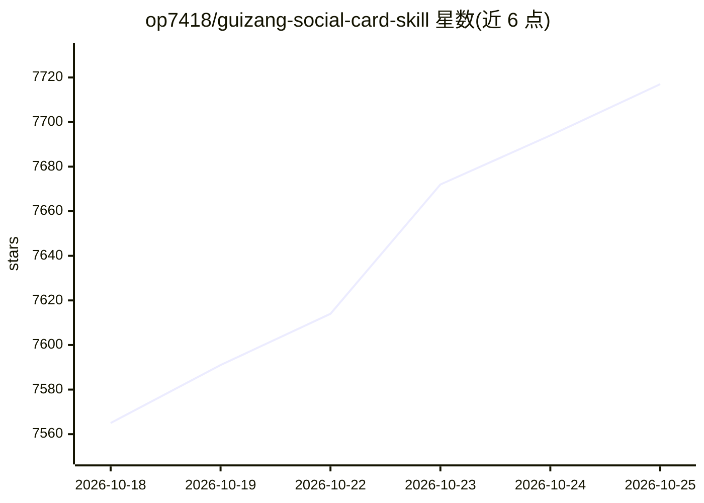

# op7418/guizang-social-card-skill

⭐ 7,717 · HTML · AGPL-3.0 · 推送 2026-07-01 · [GitHub](https://github.com/op7418/guizang-social-card-skill) · [官网](https://github.com/op7418/guizang-social-card-skill) · 个人维护 · 中文 README

**给 Claude Code/Codex 的社交卡片生成 skill：小红书图文与公众号封面**

适配 Claude Code / Codex 等 Agent 环境的技能包，从文章、截图、照片或用户视频生成小红书图文组图、Live Photo 动态卡与公众号 21:9+1:1 封面对。内置 Editorial 与 Swiss 两套视觉系统、28 个版式骨架、10 套主题预设（不允许自定义色值）；以单文件 HTML 经 Playwright 渲染为 PNG，Live Photo 分支输出 JPG+MOV+.pvt。附 9 条规则的校验脚本检测溢出与排版问题。通过 npx skills add 或 git clone 安装到 ~/.claude/skills/。

## 筛选速览

| 维度 | 判定 | 备注 |
|---|---|---|
| AI 角色 | `ai-ecosystem` | LLM/agent 周边工具 |
| 许可风险 | `viral` | AGPL-3.0 |
| 部署形态 | `library` | 以包/库形式分发 |
| 模型依赖 | locked-api |  |
| 硬件要求 | — | 无带数字的原话,不猜 |
| 安装摩擦 | `low` | 无编译、无系统依赖或容器化 |
| 成熟度 | — | 结构信号不足 |

## 能力要点

- Editorial/Swiss 双视觉系统，28 个版式骨架与 10 套主题预设
- 单文件 HTML + Playwright 渲染 PNG，无需前端构建链
- Live Photo 支持 3s/5s 时长规划，输出 JPG+MOV+.pvt 发布包
- 9 条规则的校验脚本基于真实 DOM 渲染测量

## 适用场景

- 把长文章或产品测评做成小红书图文组图
- 为公众号生成 21:9 头图 + 1:1 分享卡封面对
- 把短视频素材转成小红书 Live Photo 动态卡

## 场景标签

`图像生成` · 领域:内容生成

## 证据(README 行号)

> L13: 一个适配 Claude Code / Codex 等 Agent 环境的图文卡片技能,用于从文章、文案、截图、产品笔记、字幕、照片或用户视频生成**小红书 / Rednote 图文组图**、**Live Photo 动态卡**与*
> L62: - 📐 **3 个画板尺寸**:`.poster.xhs` 1080×1440(小红书 3:4)、`.poster.wide` 2100×900(公众号 21:9)、`.poster.square` 1080×1080(公众号 1
> L142: - **Agent 友好**:HTML + CSS 是文本,Agent 能直接写、读、改、验证

## 星数曲线

2026-10-18 7,565 → 2026-10-25 7,717（+152）

---
*卡片 v1 · prompt 1.4 · 生成 2026-10-20 · 置信度 high · 依据 README sha `cdf382f4c8a9` · [字段定义](../../DATASET.md)*
