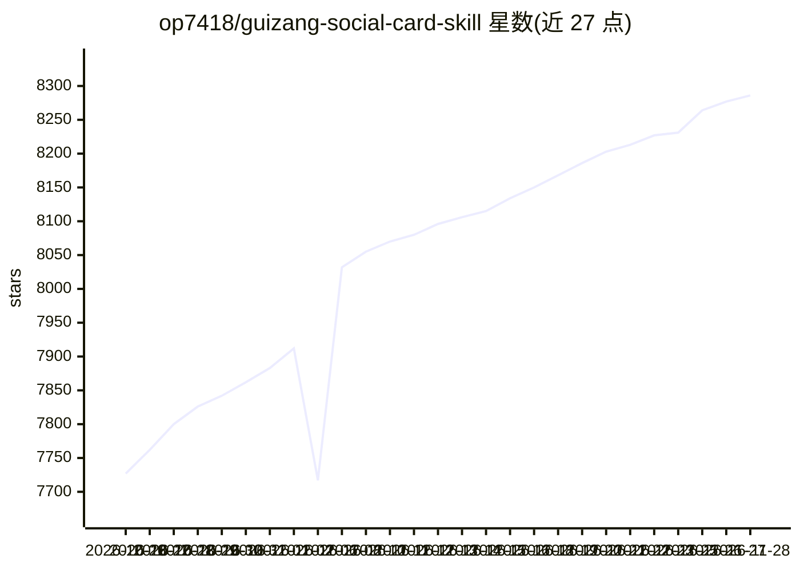

# op7418/guizang-social-card-skill

⭐ 8,286 · HTML · AGPL-3.0 · 推送 2026-10-30 · [GitHub](https://github.com/op7418/guizang-social-card-skill) · [官网](https://github.com/op7418/guizang-social-card-skill) · 个人维护 · 中文 README

**给 Agent 用的技能：从小红书图文与公众号封面**

一个适配 Claude Code / Codex 等 Agent 环境的图文卡片技能（Skill），从文章、文案、截图、视频等素材生成小红书图文组图、Live Photo 动态卡与公众号 21:9+1:1 封面对。内置 Editorial 与 Swiss 两套视觉系统、28 个版式骨架、10 套主题预设，产出单文件 HTML 后经 Node 脚本与 Playwright 截图为 PNG；附 9 条规则的版式校验脚本，支持中英文，许可证为 AGPL-3.0。

## 筛选速览

| 维度 | 判定 | 备注 |
|---|---|---|
| AI 角色 | `ai-native` | 本体是模型或模型工具 |
| 许可风险 | `viral` | AGPL-3.0 |
| 部署形态 | `library` | 以包/库形式分发 |
| 模型依赖 | — | README 未给出锁定关系 |
| 硬件要求 | — | 无带数字的原话,不猜 |
| 安装摩擦 | `low` | 无编译、无系统依赖或容器化 |
| 成熟度 | — | 结构信号不足 |

## 能力要点

- 28 个版式骨架（Editorial 16 + Swiss 12）与 10 套主题预设
- 单文件 HTML 经 Playwright 渲染为 PNG，附带 9 条溢出/字号/密度校验规则
- Live Photo 分支输出 JPG + MOV + .pvt，按平台 3s/5s 时长规划
- 图源工作流按 Unsplash→Pexels→Flickr CC→Wallhaven 优先级取图并写 SOURCES.md

## 适用场景

- 把长文章或产品测评做成小红书 3:4 图文组图
- 为公众号文章生成视觉一致的 21:9 头图加 1:1 分享卡
- 把旅行视频片段做成 Live Photo 动态卡发布

## 场景标签

`图像生成` · 领域:内容生成

## 证据(README 行号)

> L13: 一个适配 Claude Code / Codex 等 Agent 环境的图文卡片技能,用于从文章、文案、截图、产品笔记、字幕、照片或用户视频生成**小红书 / Rednote 图文组图**、**Live Photo 动态卡**与*
> L72: - 📄 **单文件 HTML + Playwright 渲染**:不需要前端构建链,`node scripts/render.mjs` 直接出 PNG

## 星数曲线

2026-10-26 7,727 → 2026-11-28 8,286（+559）

---
*卡片 v1 · prompt 1.4 · 生成 2026-11-22 · 置信度 high · 依据 README sha `a0d642673336` · [字段定义](../../DATASET.md)*
