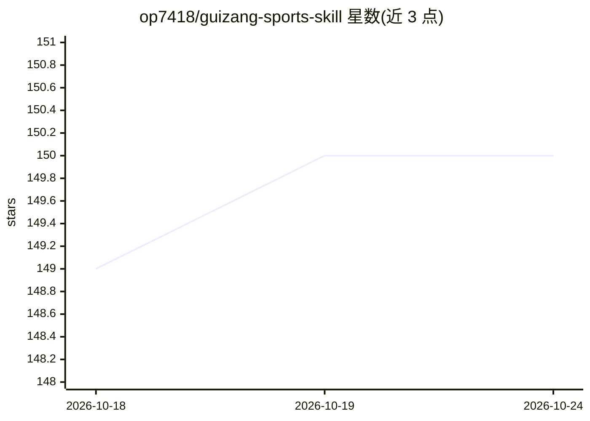

# op7418/guizang-sports-skill

⭐ 150 · JavaScript · AGPL-3.0 · 推送 2026-08-09 · [GitHub](https://github.com/op7418/guizang-sports-skill) · [官网](https://github.com/op7418/guizang-sports-skill) · 个人维护 · 中文 README

**给 Claude Code/Codex 的运动轨迹分析技能：解析 FIT/KML 生成报告**

面向 Claude Code、Codex 等本地 Agent 环境的 Skill：用户把 .fit/.kml 文件交给 Agent，Skill 提供依赖准备、轨迹解析、单次/多活动综合分析（距离、爬升、踏频、心率、功率等）、爬坡识别、本地 3D 可视化报告页 Ride Relief，以及 1080 级 PNG 与 H.264 MP4 导出。数据解释含缺失值处理与不虚构生理指标等约定。需要 Node.js 20.19+ 或 22.12+；普通 Chatbot 平台不推荐使用。

## 筛选速览

| 维度 | 判定 | 备注 |
|---|---|---|
| AI 角色 | `ai-ecosystem` | LLM/agent 周边工具 |
| 许可风险 | `viral` | AGPL-3.0 |
| 部署形态 | `library` | 以包/库形式分发 |
| 模型依赖 | — | README 未给出锁定关系 |
| 硬件要求 | — | 无带数字的原话,不猜 |
| 安装摩擦 | `low` | 无编译、无系统依赖或容器化 |
| 成熟度 | — | 结构信号不足 |

## 能力要点

- FIT/KML 单次与多活动综合分析，含传感器字段覆盖率与坡度分布
- 自带本地报告网页 Ride Relief，仅监听本机地址
- PNG 与 H.264 MP4（30 FPS、12 Mbps）多比例导出与沿途照片故事
- 明确的数据解释原则：缺失与 0 分离、不虚构 FTP/VO₂max 等指标

## 适用场景

- 把骑行或跑步的 FIT 文件交给 Agent 生成分析报告
- 把多次活动做成综合对比，找最长、爬升最多的一次
- 把路线制作成 9:16 竖屏 3D 路线视频分享到社交媒体

## 场景标签

`数据分析` · 领域:效率与自动化

## 证据(README 行号)

> L10: 一个面向 Claude Code、Codex 等本地 Agent 环境的运动轨迹 Skill。把一个或多个 `.fit` / `.kml` 文件交给 Agent，它会分析骑行、跑步或徒步数据，生成有依据的结论与建议，并自动打开本地
> L105: |Claude Code|支持|可读取本地轨迹、执行分析并打开报告页|

## 星数曲线

2026-10-18 149 → 2026-10-24 150（+1）

---
*卡片 v1 · prompt 1.4 · 生成 2026-10-22 · 置信度 high · 依据 README sha `7ed149dddeff` · [字段定义](../../DATASET.md)*
