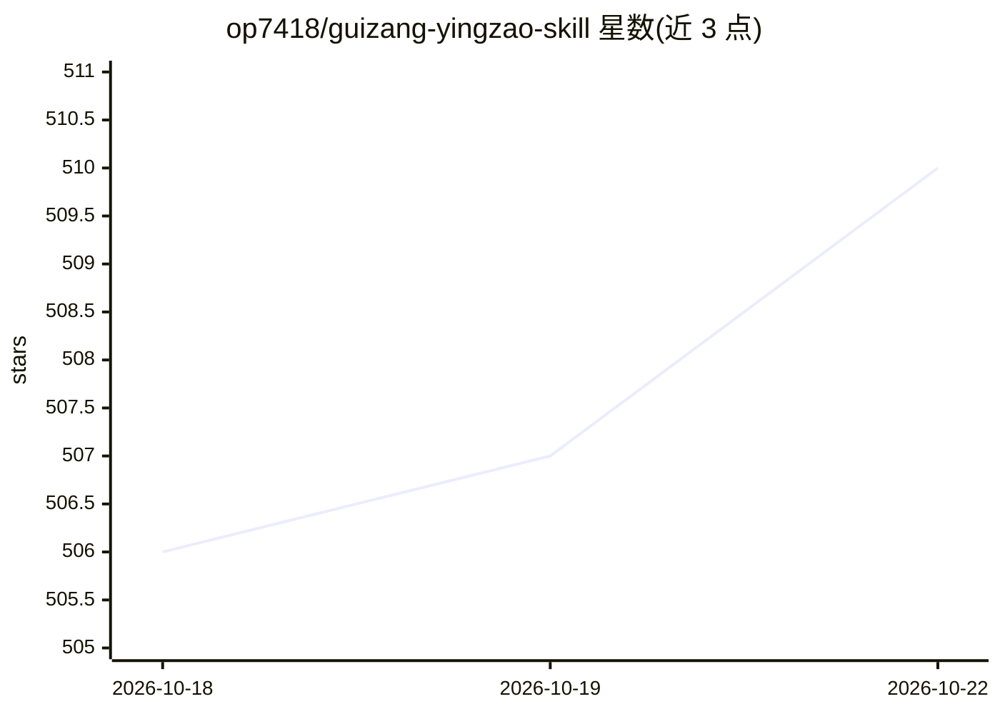

# op7418/guizang-yingzao-skill

⭐ 511 · Python · 推送 2026-09-03 · [GitHub](https://github.com/op7418/guizang-yingzao-skill) · 个人维护 · 中文 README

**把中国古建筑与文化照片转成艺术指导编辑海报的 Agent 技能**

面向支持 Skills 的 Agent（如 Claude Code / Codex）的技能包：读取用户拍摄的建筑、街巷、器物与食物照片，先做构图与身份识别，再从内置 Recipe 与参考图中选择方向，设计中文展示字与图文空间关系，将原图、主导参考与排版垫图连同提示词交给图像模型完成整体重绘。生成前做事实边界、字体覆盖、碰撞等确定性检查，生成后读图一次报告问题，不自动重生成。需要 Python 3.10+ 及 Pillow、NumPy、OpenCV、fontTools，通过 npx skills add 安装。

## 筛选速览

| 维度 | 判定 | 备注 |
|---|---|---|
| AI 角色 | `ai-ecosystem` | LLM/agent 周边工具 |
| 许可风险 | `none` | — |
| 部署形态 | `library` | 以包/库形式分发 |
| 模型依赖 | — | README 未给出锁定关系 |
| 硬件要求 | — | 无带数字的原话,不猜 |
| 安装摩擦 | `low` | 无编译、无系统依赖或容器化 |
| 成熟度 | — | 结构信号不足 |

## 能力要点

- 三类视觉输入（原图/主导参考/排版垫图）与 Recipe Token 机制完成图像模型调用
- 生成前确定性门控：事实边界、字体 cmap 覆盖、碰撞、禁穿区检查
- 保护建筑身份锚点（屋坡、飞檐、匾额、轮廓），不做无依据虚构
- 海报完成后可扩展 3×3 视频分镜图与视频模型提示词

## 适用场景

- 把旅行拍摄的古城、寺庙照片做成单图编辑海报
- 多张同主题照片融合为一个共同场景的横版海报
- 需要中文展示字设计与图文互动的视觉作品

## 场景标签

`图像生成` · 领域:内容生成

## 证据(README 行号)

> L7: Yingzao 会先读照片的构图与身份，再选择一张兼容的主导参考，设计中文展示字与图文空间关系，最后把原图、参考与稀疏排版垫图一起交给图像模型完成整体重绘。主体处理、主动色场、地域材质和文字遮挡发生在同一个视觉世界里。
> L104: - 一个支持 Skills、读取本地图片并调用图像生成/编辑工具的 Agent

## 星数曲线

2026-10-18 506 → 2026-10-22 510（+4）

---
*卡片 v1 · prompt 1.4 · 生成 2026-10-21 · 置信度 mid · 依据 README sha `7dd7b0ea4cce` · [字段定义](../../DATASET.md)*
