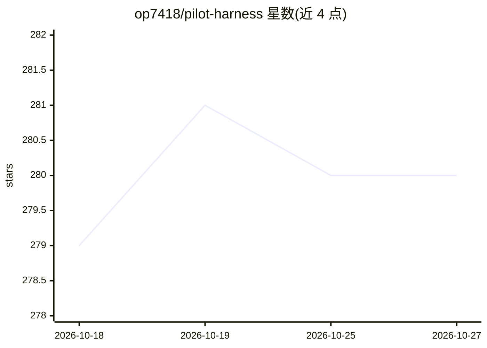

# op7418/pilot-harness

⭐ 280 · TypeScript · MIT · 推送 2026-09-10 · [GitHub](https://github.com/op7418/pilot-harness) · 个人维护 · 中文 README

**DeepSeek Harness 的桌面客户端与插件套件，可视化管模型与 Provider**

基于 Electron 打包本地 DeepSeek Harness 插件运行时的桌面应用，支持 macOS/Windows/Linux 三平台安装包。提供 CodePilot 风格界面、Provider 与 OpenAI 兼容端点管理、凭据分离管理、实时模型目录与图像能力标注、工作区文件侧栏、Session 日志 ZIP 导出等功能。扩展以普通 Harness 插件形式实现，可独立于桌面端在 Web profile 中用 dsh 命令安装。不改动 Harness 的 agent 循环、工具管道与 RPC 实现，Electron 只负责打包与原生集成。

## 筛选速览

| 维度 | 判定 | 备注 |
|---|---|---|
| AI 角色 | `ai-ecosystem` | LLM/agent 周边工具 |
| 许可风险 | `permissive` | MIT |
| 部署形态 | `desktop` | 安装包/桌面程序 |
| 模型依赖 | locked-api |  |
| 硬件要求 | — | 无带数字的原话,不猜 |
| 安装摩擦 | `low` | 无编译、无系统依赖或容器化 |
| 成熟度 | — | 结构信号不足 |

## 能力要点

- Electron 打包本地 DeepSeek Harness 运行时，三平台提供 DMG/EXE/AppImage/DEB/RPM 安装包
- Provider 管理：连接供应商、声明 OpenAI 兼容端点、浏览实时模型目录、标识图像能力模型
- 四个插件（CodePilot 主题/文件侧栏/提醒摘要/Session 导出）可独立安装到 Web profile
- 每日自动同步上游 DeepSeek Harness 发布并走原生 CI 发布流水线

## 适用场景

- 在桌面端以原生窗口方式日常使用 DeepSeek Harness 而非 CLI 启动的 Web UI
- 可视化配置 Provider、凭据并挑选多模态模型
- 为已有 Web profile 单独加装文件侧栏或 Session 导出插件

## 场景标签

`编码 Agent` · 领域:编码与开发

## 证据(README 行号)

> L9:  Run the DeepSeek Harness plugin runtime as a focused native app, manage providers and multimodal models visually, a
> L26: - **Provider and model management** — connect supported providers, declare an OpenAI-compatible endpoint, manage cr
> L31: Pilot Harness does not replace the DeepSeek Harness agent loop, Session log, tool pipeline, provider contracts, or 

## 星数曲线

2026-10-18 279 → 2026-10-27 280（+1）

---
*卡片 v1 · prompt 1.4 · 生成 2026-10-22 · 置信度 mid · 依据 README sha `233a94dc4976` · [字段定义](../../DATASET.md)*
