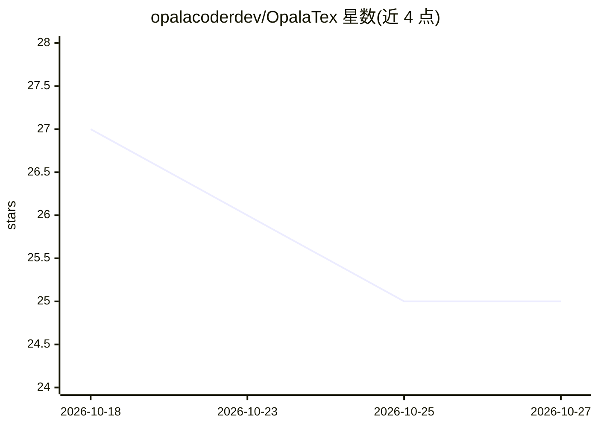

# opalacoderdev/OpalaTex

⭐ 25 · Python · MIT · 推送 2026-10-26 · [GitHub](https://github.com/opalacoderdev/OpalaTex) · [官网](https://opalacoder.com) · 组织维护

**带 AI 助手的本地 LaTeX 编辑器，支持本地编译与可选模型**

开源 LaTeX 编辑器，含源码编辑、本地 PDF 预览（SyncTeX）、Git 集成与项目/终端/导出工具；LaTeX 编译由本地 Tectonic 完成，无需账号。AI 助手可选本地 Ollama 或自备 API key 的云端提供商，用于写作、表格、公式、TikZ 与编译错误处理。提供桌面安装包（Linux/macOS curl 一行安装、Windows PowerShell）与 pip 安装的 CLI 版本；桌面版功能（预览、批注、听写等）在 CLI 中不可用。开发需 Python 3.10+ 与 Node.js/npm。

## 筛选速览

| 维度 | 判定 | 备注 |
|---|---|---|
| AI 角色 | `ai-enhanced` | 去掉 AI 部分产品仍成立 |
| 许可风险 | `permissive` | MIT |
| 部署形态 | `library` | 以包/库形式分发 |
| 模型依赖 | local-ok | 支持本地模型 |
| 硬件要求 | — | 无带数字的原话,不猜 |
| 安装摩擦 | `low` | 无编译、无系统依赖或容器化 |
| 成熟度 | — | 结构信号不足 |

## 能力要点

- 本地 Tectonic 编译 LaTeX，全部编辑功能无需账号
- AI 助手支持本地 Ollama 与可配置外部提供商（可选）
- 同一 agent 兼具桌面版与 CLI 版（/providers、/models 脚本化管理）
- 提供 Linux/macOS/Windows 免管理员权限安装包与卸载命令

## 适用场景

- 在本地撰写与编译 LaTeX 论文、教程或演示文稿
- 用 AI 助手辅助写作、生成表格/公式/TikZ 或排查编译错误
- 在终端用 CLI 对论文项目运行同一 agent

## 场景标签

 · 领域:学术写作/桌面工具

## 证据(README 行号)

> L3: OpalaTex is a free, open-source LaTeX editor with an integrated AI assistant. It combines a source editor, local PDF
> L5: LaTeX compilation is performed locally with Tectonic. All editor features work without any account; user-provided AP
> L11: - AI assistance for writing, tables, equations, TikZ, and compilation errors

## 星数曲线

2026-10-18 27 → 2026-10-27 25（-2）

---
*卡片 v1 · prompt 1.4 · 生成 2026-10-27 · 置信度 high · 依据 README sha `022fdeaa93f8` · [字段定义](../../DATASET.md)*
