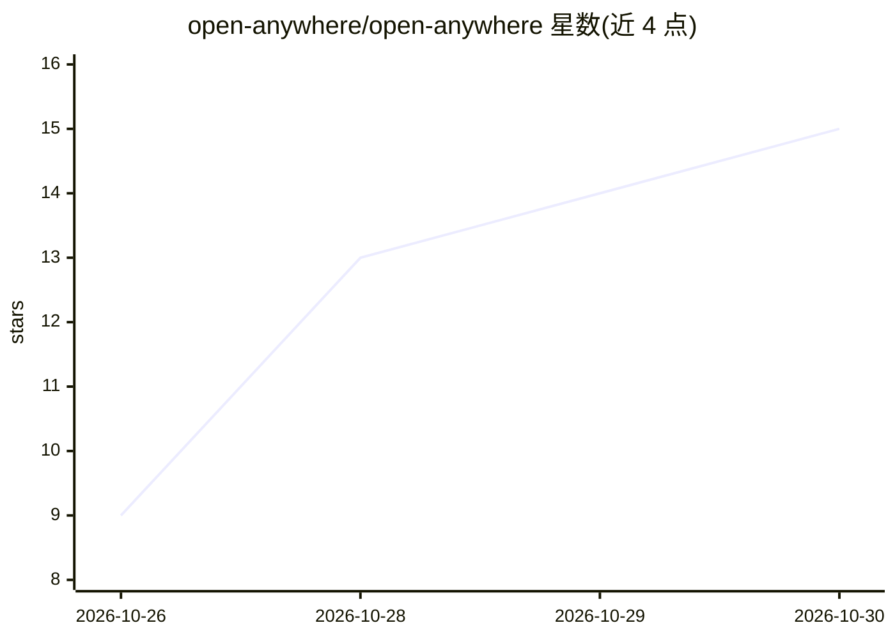

# open-anywhere/open-anywhere

⭐ 15 · Go · 推送 2026-10-25 · [GitHub](https://github.com/open-anywhere/open-anywhere) · [官网](https://www.bilibili.com/video/BV1AznU6YELm/) · 组织维护 · 中文 README

**语音一句话让云端 Agent 当场生成 Web 应用并投屏到电视**

面向民宿、轰趴馆、桌游店等活动场地方的系统：用户用语音描述需求，云端编码 Agent（AgentAPI）在隔离环境生成可运行的 Web 应用，通过 DLNA（MPEG-TS）投到电视或投影上，生成应用以 OpenAPI 声明操作，控制面提供 MCP 工具，语音可在运行时继续操作应用。由 Go 实现的四个组件构成：Gateway（控制面/Portal）、Render（Chromium 渲染与媒体流）、Casting（DLNA 投屏）、voiceentry（模拟灵矽语音硬件的本地控制台）。源码自行构建运行，Render 主机需 Node.js 20、Chromium、带 libx264 与 AAC 的 FFmpeg 及 lsof；现场语音入口目前由本地程序模拟灵矽硬件，AirPlay 为后续扩展。

## 筛选速览

| 维度 | 判定 | 备注 |
|---|---|---|
| AI 角色 | `ai-native` | 本体是模型或模型工具 |
| 许可风险 | `none` | — |
| 部署形态 | `None` |  |
| 模型依赖 | — | README 未给出锁定关系 |
| 硬件要求 | — | 无带数字的原话,不猜 |
| 安装摩擦 | `medium` | 含编译或系统依赖之一 |
| 成熟度 | — | 结构信号不足 |

## 能力要点

- 语音描述 → AgentAPI 生成应用 → DLNA 上屏 → 语音运行时操作的完整链路
- 生成应用以 OpenAPI 声明操作，语音侧仅保留读操作表与发请求两个通用 MCP 工具
- Go 实现 Gateway/Render/Casting/voiceentry 四组件，支持多租户 Portal 与控制面重启恢复

## 适用场景

- 活动现场让 AI 当场生成知识竞赛、大富翁等游戏并投到大屏
- 民宿或轰趴馆为每场客人定制一次性的互动应用
- 做饭、亲子阅读等家庭场景生成分步菜谱或翻页读物并语音操作

## 场景标签

`代码生成` `语音 Agent` · 领域:编码与开发

## 证据(README 行号)

> L19: **Open Anywhere** 让人用一句话描述此刻的需要，由云端编码 Agent 当场生成一个可运行的 Web 应用，投到身边的屏幕上，并继续用语音操作它：
> L71: |写代码|AgentAPI|在隔离环境里生成应用并自测|
> L74: 生成的应用把每个操作都声明成 OpenAPI，控制面提供稳定的 MCP 工具，所以语音不只能创建它，还能在运行时操作它：开始、下一题、查比分，都是一次业务调用。

## 星数曲线

2026-10-26 9 → 2026-10-30 15（+6）

---
*卡片 v1 · prompt 1.4 · 生成 2026-10-30 · 置信度 high · 依据 README sha `2b1201ffbfc2` · [字段定义](../../DATASET.md)*
