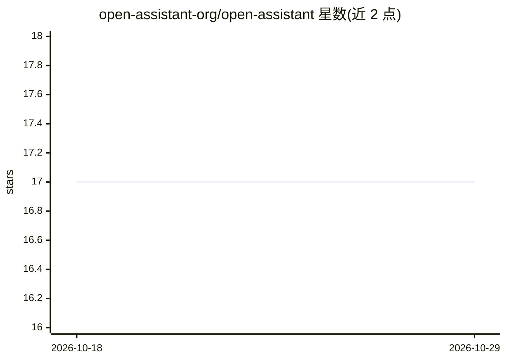

# open-assistant-org/open-assistant

⭐ 17 · Python · NOASSERTION · 推送 2026-10-28 · [GitHub](https://github.com/open-assistant-org/open-assistant) · [官网](https://open-assistant.org) · 组织维护

**自托管个人 AI 助手：把邮件/日历/文件/笔记统一进对话**

以单个 Docker 容器运行的自托管单用户 AI 助手：协调 agent 将请求路由到 10 个内置专家 agent，通过 165+ 工具操作 Gmail/Outlook 邮件、日历、OneDrive/Nextcloud 文件、Notion 笔记、WhatsApp/Slack 消息及 Playwright 浏览器等集成；支持拖拽分配工具、artifacts 保存、定时任务与远程 MCP 服务器。LLM 后端可选 OpenRouter、Anthropic、Groq 或本地 Ollama/vLLM 离线运行，凭据 Fernet 加密存储。提供 Web UI，许可为 BUSL-1.1。

## 筛选速览

| 维度 | 判定 | 备注 |
|---|---|---|
| AI 角色 | `ai-native` | 本体是模型或模型工具 |
| 许可风险 | `none` | NOASSERTION |
| 部署形态 | `self-host` | docker 或自建部署 |
| 模型依赖 | local-ok | 支持本地模型 |
| 硬件要求 | — | 无带数字的原话,不猜 |
| 安装摩擦 | `low` | 无编译、无系统依赖或容器化 |
| 成熟度 | — | 结构信号不足 |

## 能力要点

- 协调 agent + 10 个内置专家 agent、165+ 可拖拽分配的工具
- Gmail/日历/文件/Notion/WhatsApp/Slack 等集成，各自独立启用
- 支持远程 MCP 服务器、插件系统与自定义 agent
- 可选 Ollama/vLLM 完全离线运行，凭据 Fernet 加密

## 适用场景

- 自托管一个能代我查邮件、订日程、找文件的私人助手
- 通过 WhatsApp 或 Slack 与助手双向对话（文字/语音/图片）
- 数据不出自有基础设施地使用 LLM 自动化日常事务

## 场景标签

`AI 助手` · 领域:对话与助手

## 证据(README 行号)

> L19: Most AI chatbots only talk. Open Assistant runs as a single Docker container and plugs your LLM into your **email, 
> L33: A **coordinator agent** routes each request to the right specialist — research, communication, writing, file handli
> L53: - 🔓 **No lock-in** — Bring your own brain: OpenRouter, Anthropic, Groq, or run fully offline with Ollama / vLLM.

## 星数曲线

2026-10-18 17 → 2026-10-29 17（+0）

---
*卡片 v1 · prompt 1.4 · 生成 2026-10-29 · 置信度 mid · 依据 README sha `86b51a43278f` · [字段定义](../../DATASET.md)*
