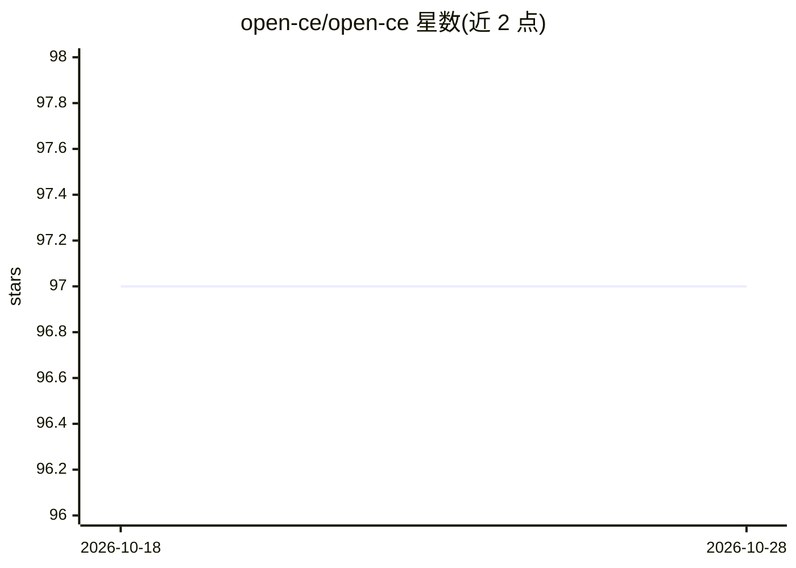

# open-ce/open-ce

⭐ 97 · Apache-2.0 · 推送 2026-05-08 · [GitHub](https://github.com/open-ce/open-ce) · [官网](https://github.com/open-ce) · 组织维护

**为机器学习/深度学习框架构建 conda 包的环境定义与 feedstock 集合**

Open-CE 项目提供 feedstock 收集、环境数据与构建脚本，用于为一批机器学习和深度学习框架（含 TensorFlow、PyTorch 等）构建可安装在同一 conda 环境中的 conda 包。构建时可指定 Python（3.10/3.11）与 CUDA（11.8/12.2）变体，支持 Power、x86、s390x 架构。Oregon State University 与 MIT 托管预构建社区渠道，Rocket Software 提供 Power 架构的企业支持渠道；也可配合 open-ce-builder 工具自行构建。运行要求仅有 conda。

## 筛选速览

| 维度 | 判定 | 备注 |
|---|---|---|
| AI 角色 | `ai-ecosystem` | LLM/agent 周边工具 |
| 许可风险 | `permissive` | Apache-2.0 |
| 部署形态 | `None` |  |
| 模型依赖 | — | README 未给出锁定关系 |
| 硬件要求 | — | 无带数字的原话,不猜 |
| 安装摩擦 | `medium` | 含编译或系统依赖之一 |
| 成熟度 | — | 结构信号不足 |

## 能力要点

- 提供 ML/DL 框架的 conda 包构建环境定义与版本文件
- 构建时可选 Python 3.10/3.11 与 CUDA 11.8/12.2 变体
- 支持 Power、x86、s390x 三种架构
- 提供 OSU/MIT 社区渠道与 Rocket Software 企业支持渠道的预构建包

## 适用场景

- 通过 conda 渠道安装经过统一构建的深度学习框架包
- 在 Power/s390x 等非 x86 架构上获取 ML 框架的预构建包
- 自建 conda 渠道统一管理多框架的依赖版本

## 场景标签

 · 领域:AI 基础设施/软件分发

## 证据(README 行号)

> L12: Welcome to the **open-ce** project. The project contains everything that is needed to build conda packages for
> L13: a collection of machine learning and deep learning frameworks. All packages created for a specific version of
> L17: This repository contains a collection of Open-CE files that can be used to create a conda channel. The conda channe

## 星数曲线

2026-10-18 97 → 2026-10-28 97（+0）

---
*卡片 v1 · prompt 1.4 · 生成 2026-10-23 · 置信度 high · 依据 README sha `ecd520305954` · [字段定义](../../DATASET.md)*
