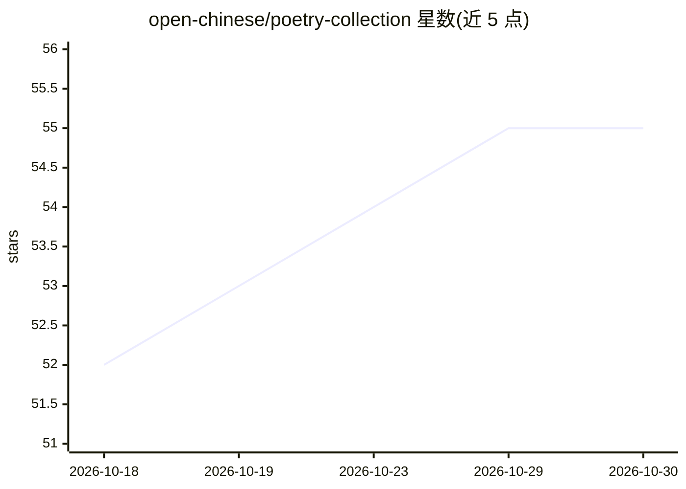

# open-chinese/poetry-collection

⭐ 55 · Python · MIT · 推送 2026-10-25 · [GitHub](https://github.com/open-chinese/poetry-collection) · 个人维护 · 中文 README

**37 万首中文诗词曲赋的统一建模数据集**

中文诗词数据集合：收录约 37 万首诗词曲赋，按每卷 1000 首分为 370 卷存放于 volumes 目录，内容从《诗经》到清代作品。每首诗标准化为 JSON 格式（uuid 采用标题-作者-内容的 content hash），全部使用简体中文，并经过 uuid 统一与多轮去重。项目借助 LLM 能力规划了校正、鉴赏、翻译、评分等迭代方向，已发布第一版全唐诗 AI 鉴赏评分。给需要中文诗词语料的数据使用者与研究者使用。

## 筛选速览

| 维度 | 判定 | 备注 |
|---|---|---|
| AI 角色 | `ai-knowledge` | 知识聚合/清单类 |
| 许可风险 | `permissive` | MIT |
| 部署形态 | `None` |  |
| 模型依赖 | — | README 未给出锁定关系 |
| 硬件要求 | — | 无带数字的原话,不猜 |
| 安装摩擦 | `low` | 无编译、无系统依赖或容器化 |
| 成熟度 | — | 结构信号不足 |

## 能力要点

- 收录约 37 万首诗词曲赋，分为 370 卷
- 统一 JSON 数据建模，uuid 基于 content hash
- 已完成 uuid 统一与去重（共去重逾 1.3 万首）
- 规划 AI 鉴赏、翻译、评分等迭代方向

## 适用场景

- 获取覆盖多个朝代、格式统一的中文诗词语料
- 为 LLM 训练或文学研究提供诗词数据
- 按诗人、朝代维度统计与分析作品分布

## 场景标签

 · 领域:文学/数据集

## 证据(README 行号)

> L3:  **全网最全的诗词数据集！目前累计收录37万首诗词曲赋，共分为370卷，每卷1000首，见 ./volumes 目录。**
> L56: 每一首诗词统一数据建模，标准化为如下的json格式，所有内容使用将简体中文

## 星数曲线

2026-10-18 52 → 2026-10-30 55（+3）

---
*卡片 v1 · prompt 1.4 · 生成 2026-10-24 · 置信度 high · 依据 README sha `a6da8c370bad` · [字段定义](../../DATASET.md)*
