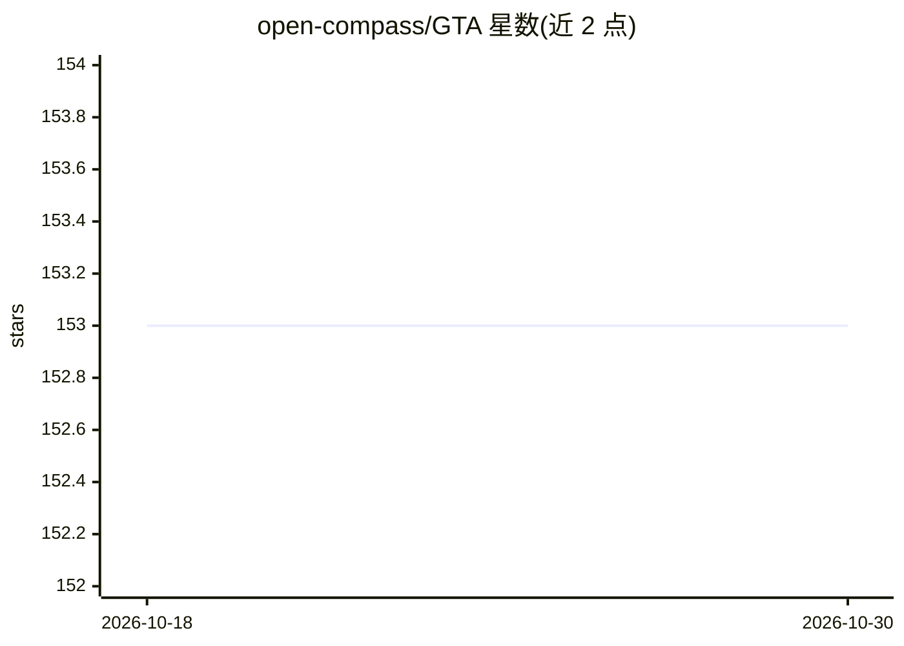

# open-compass/GTA

⭐ 153 · Python · Apache-2.0 · 推送 2026-10-24 · [GitHub](https://github.com/open-compass/GTA) · 组织维护 · 中文 README

**通用工具型 Agent 的分层评测基准与评测套件**

NeurIPS 2024 收录的 GTA 基准及其扩展 GTA-2：在同一仓库内提供原子级工具调用评测（GTA-Atomic，人工构建的短程任务）与开放式长程工作流评测（GTA-Workflow，来自 Manus/Kortix/Reddit 等真实工作流任务，含人机协同管线）。既评测底层 LLM 也评测执行 harness，默认基于 OpenCompass + Lagent 管线，支持自定义 agent/LLM 接入，以及对 Manus、Kortix、OpenClaw 等封闭系统的端到端结果评测，评分以最终交付物为中心。面向 agent 研究与评测人员。

## 筛选速览

| 维度 | 判定 | 备注 |
|---|---|---|
| AI 角色 | `ai-ecosystem` | LLM/agent 周边工具 |
| 许可风险 | `permissive` | Apache-2.0 |
| 部署形态 | `library` | 以包/库形式分发 |
| 模型依赖 | — | README 未给出锁定关系 |
| 硬件要求 | — | 无带数字的原话,不猜 |
| 安装摩擦 | `medium` | 含编译或系统依赖之一 |
| 成熟度 | — | 结构信号不足 |

## 能力要点

- GTA-Workflow 面向长程开放式工作流，以交付物为中心打分
- 同时评测 LLM 与 agent 执行 harness 两层
- 默认 OpenCompass + Lagent 管线，支持自定义 agent/LLM 封装接入
- 对无法集成的封闭 agent 系统（Manus/Kortix/OpenClaw 等）支持端到端结果评测

## 适用场景

- 评测自研 agent 框架在真实生产力任务上的长程完成能力
- 在排行榜上对比 GPT、Gemini、Claude、DeepSeek 等模型的工具调用表现
- 对产品化 agent 系统只取最终输出做端到端评测

## 场景标签

`模型评测` · 领域:评测与运维

## 证据(README 行号)

> L11: GTA-2 is a benchmark and evaluation kit for **General Tool Agents**, designed to bridge **atomic tool-use evaluatio
> L25: - **Both model and harness evaluation.**
> L28: - **Default OpenCompass-based evaluation.**

## 星数曲线

2026-10-18 153 → 2026-10-30 153（+0）

---
*卡片 v1 · prompt 1.4 · 生成 2026-10-22 · 置信度 mid · 依据 README sha `800219dd0aaf` · [字段定义](../../DATASET.md)*
