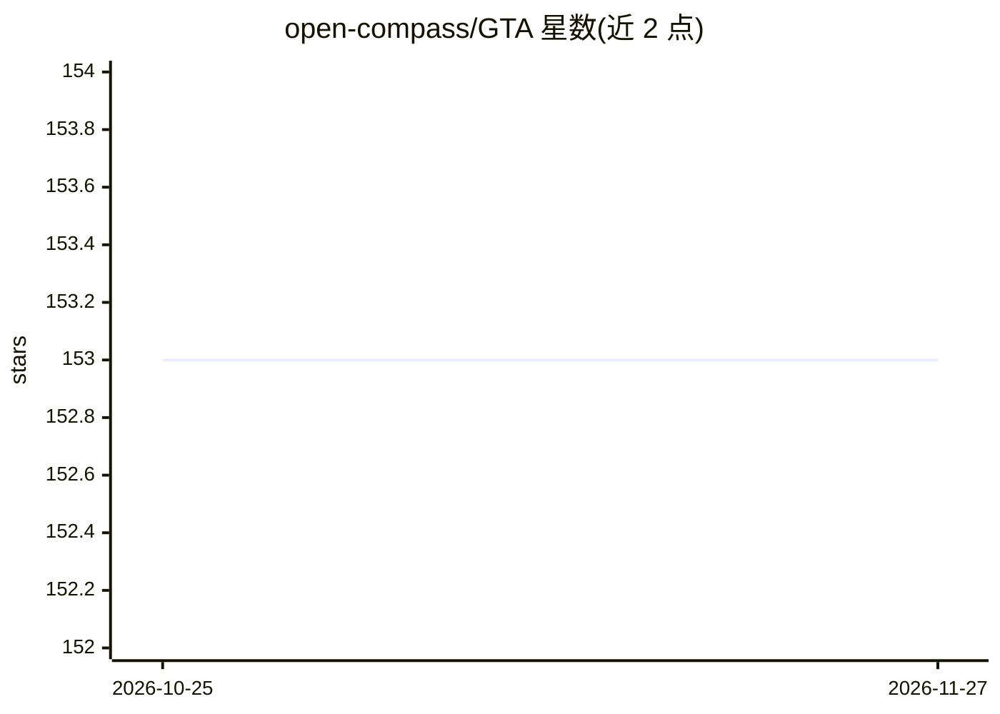

# open-compass/GTA

⭐ 153 · Python · Apache-2.0 · 推送 2026-11-10 · [GitHub](https://github.com/open-compass/GTA) · 组织维护

**通用工具智能体基准与评测框架，覆盖原子调用到开放式工作流**

GTA-2 是面向通用工具智能体的基准与评测套件，包含两部分：GTA-Workflow 针对长时程开放式生产力任务，以最终交付物为评分核心；GTA-Atomic 为原有的短时程原子工具调用基准。默认提供 OpenCompass + Lagent 的评测流水线，支持接入自定义 agent 框架或 LLM 后端；对无法集成的闭源 agent 系统（如 Manus、Kortix、OpenClaw），支持直接评测最终执行结果。数据集通过 GitHub release 与 Hugging Face 分发，评测需部署 LMDeploy 模型服务与 AgentLego 工具服务。

## 筛选速览

| 维度 | 判定 | 备注 |
|---|---|---|
| AI 角色 | `ai-ecosystem` | LLM/agent 周边工具 |
| 许可风险 | `permissive` | Apache-2.0 |
| 部署形态 | `library` | 以包/库形式分发 |
| 模型依赖 | — | README 未给出锁定关系 |
| 硬件要求 | — | 无带数字的原话,不猜 |
| 安装摩擦 | `medium` | 含编译或系统依赖之一 |
| 成熟度 | — | 结构信号不足 |

## 能力要点

- GTA-Workflow 以交付物为中心的长时程工作流评测
- 同时评测 LLM 能力与 agent 执行框架（harness）
- 支持无 OpenCompass 的端到端结果评测
- 提供自定义 agent / 自定义 LLM 后端的接入文档

## 适用场景

- 为工具调用类 agent 在标准基准上跑分并对比榜单
- 评估 Manus/OpenClaw 类闭源 agent 产品的最终交付结果
- 用自己的 agent 框架接入基准做工作流能力测试

## 场景标签

`模型评测` · 领域:评测与运维

## 证据(README 行号)

> L15: GTA-2 is a benchmark and evaluation kit for **General Tool Agents**, designed to bridge **atomic tool-use evaluatio
> L33:  We provide a standard evaluation pipeline based on **OpenCompass + Lagent**, suitable for agents integrated as cal
> L39:  For agent products or closed systems that cannot be directly integrated into our framework, GTA-2 also supports ev

## 星数曲线

2026-10-25 153 → 2026-11-27 153（+0）

---
*卡片 v1 · prompt 1.4 · 生成 2026-11-27 · 置信度 mid · 依据 README sha `f62ef68e7a6d` · [字段定义](../../DATASET.md)*
