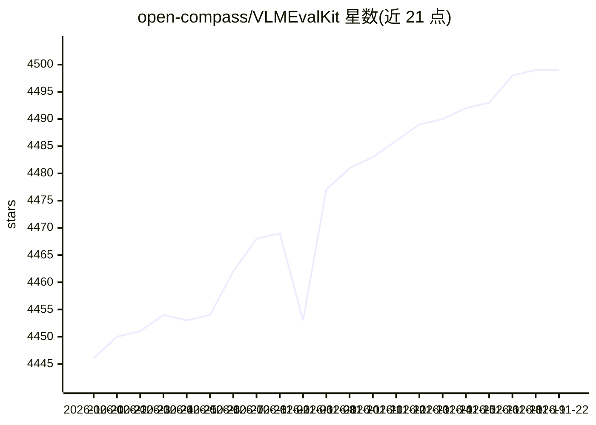

# open-compass/VLMEvalKit

⭐ 4,499 · Python · Apache-2.0 · 推送 2026-11-19 · [GitHub](https://github.com/open-compass/VLMEvalKit) · [官网](https://huggingface.co/spaces/opencompass/open_vlm_leaderboard) · 组织维护 · 中文 README

**面向研究者的多模态大模型评测工具包**

VLMEvalKit（Python 包名 vlmeval）是大型视觉语言模型的开源评测工具包，支持一条命令在多个基准上评测 LVLM/LMM，免去跨仓库准备数据的负担。采用生成式评测，提供精确匹配与基于 LLM 的答案抽取两种判分方式。支持 220+ 模型与 80+ 图像/视频基准，可用 LMDeploy 或 VLLM 做多节点分布式推理加速评测，开发者只需实现单个 generate_inner() 即可接入自有模型。注：默认不保证复现第三方基准论文的原始数值。

## 筛选速览

| 维度 | 判定 | 备注 |
|---|---|---|
| AI 角色 | `ai-ecosystem` | LLM/agent 周边工具 |
| 许可风险 | `permissive` | Apache-2.0 |
| 部署形态 | `library` | 以包/库形式分发 |
| 模型依赖 | local-ok | 支持本地模型 |
| 硬件要求 | — | 无带数字的原话,不猜 |
| 安装摩擦 | `low` | 无编译、无系统依赖或容器化 |
| 成熟度 | — | 结构信号不足 |

## 能力要点

- 一条命令评测 LVLM，覆盖 220+ 模型与 80+ 基准
- 生成式评测：精确匹配 + LLM 答案抽取双判分
- LMDeploy/VLLM 多节点分布式推理加速评测
- 新增音频模态评测（MMSU 基准）与 thinking 模型支持

## 适用场景

- 在统一流水线中复现多篇论文的多模态基准结果
- VLM 开发者为自研模型接入多基准评测
- 构建团队自有的多模态模型排行榜

## 场景标签

`模型评测` · 领域:评测与运维

## 证据(README 行号)

> L23: **VLMEvalKit** (the python package name is **vlmeval**) is an **open-source evaluation toolkit** of **large vision-
> L41: - **[2025-05-24]** To facilitate faster evaluations for large-scale or thinking models, **VLMEvalKit supports multi
> L124: 1. Provide an **easy-to-use**, **opensource evaluation toolkit** to make it convenient for researchers & developer

## 星数曲线

2026-10-20 4,446 → 2026-11-22 4,499（+53）

---
*卡片 v1 · prompt 1.4 · 生成 2026-11-22 · 置信度 mid · 依据 README sha `d6efb7d1d3ea` · [字段定义](../../DATASET.md)*
