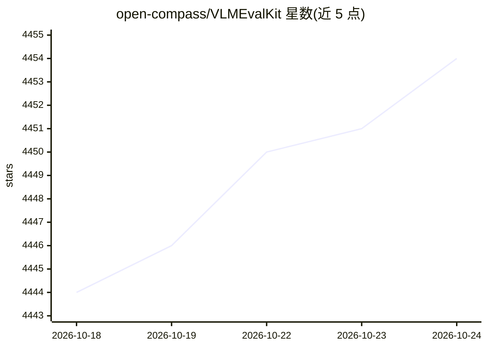

# open-compass/VLMEvalKit

⭐ 4,454 · Python · Apache-2.0 · 推送 2026-10-22 · [GitHub](https://github.com/open-compass/VLMEvalKit) · [官网](https://huggingface.co/spaces/opencompass/open_vlm_leaderboard) · 组织维护 · 中文 README

**大型视觉-语言模型评测工具包：一条命令跑通多基准测试**

VLMEvalKit（Python 包名 vlmeval）是开源的大型视觉-语言模型（LVLM）评测工具包，面向研究人员与开发者，支持 200+ 视觉-语言模型和 70+ 图像与视频基准的一键评测，省去多仓库数据准备工作。机制上采用生成式评测，配合精确匹配与 LLM 辅助答案抽取两种判分方式；新增思考模式拆分（SPLIT_THINK）与长回答 TSV 存储（PRED_FORMAT=tsv），支持经 LMDeploy/VLLM 的多节点分布式推理。局限：不保证复现第三方基准论文的精确数值，部分模型需指定 transformers/torchvision/flash-attn 版本。

## 筛选速览

| 维度 | 判定 | 备注 |
|---|---|---|
| AI 角色 | `ai-ecosystem` | LLM/agent 周边工具 |
| 许可风险 | `permissive` | Apache-2.0 |
| 部署形态 | `library` | 以包/库形式分发 |
| 模型依赖 | local-ok | 支持本地模型 |
| 硬件要求 | — | 无带数字的原话,不猜 |
| 安装摩擦 | `low` | 无编译、无系统依赖或容器化 |
| 成熟度 | — | 结构信号不足 |

## 能力要点

- 一条命令完成 200+ LVLM 在 70+ 基准上的评测
- 生成式评测，支持精确匹配与 LLM 辅助答案抽取
- 思考模式输出解析与长回答（>16k/32k token）TSV 存储
- 经 LMDeploy/VLLM 支持多节点分布式推理加速

## 适用场景

- 在多个公开基准上评测自己的视觉-语言模型
- 复现或对比官方多模态榜单结果
- 为新 VLM 接入：只需实现单个 generate_inner() 函数即可跑全部基准

## 场景标签

`模型评测` `多模态` · 领域:评测与运维

## 证据(README 行号)

> L23: **VLMEvalKit** (the python package name is **vlmeval**) is an **open-source evaluation toolkit** of **large vision-
> L116: 1. Provide an **easy-to-use**, **opensource evaluation toolkit** to make it convenient for researchers & developer

## 星数曲线

2026-10-18 4,444 → 2026-10-24 4,454（+10）

---
*卡片 v1 · prompt 1.4 · 生成 2026-10-21 · 置信度 mid · 依据 README sha `d89deee757a1` · [字段定义](../../DATASET.md)*
