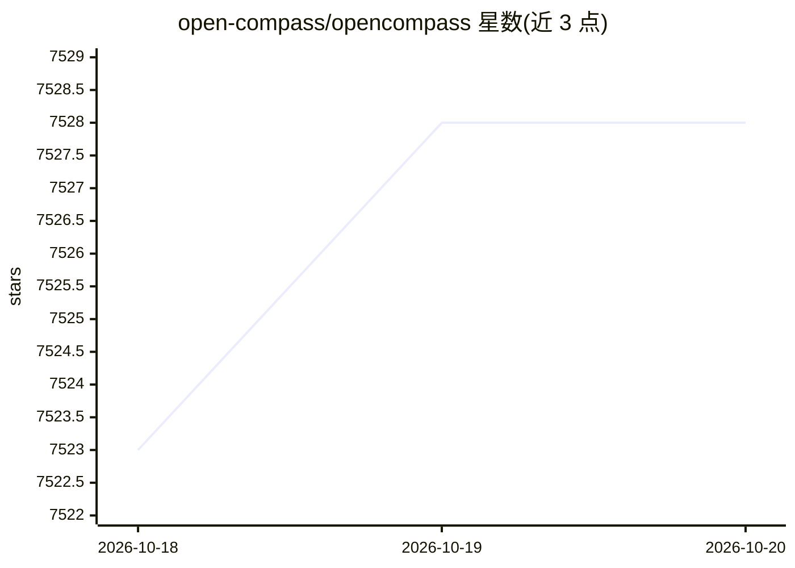

# open-compass/opencompass

⭐ 7,528 · Python · Apache-2.0 · 推送 2026-10-16 · [GitHub](https://github.com/open-compass/opencompass) · [官网](https://opencompass.org.cn/) · 组织维护 · 中文 README

**大模型评测平台：配置数据集与模型、推理、评测到汇总的一站式流程**

面向 LLM/VLM 评测的一站式平台，覆盖数据集与模型配置、推理、评测、结果汇总的完整流程。支持 OpenAI、Anthropic、Gemini、Qwen、GLM、DeepSeek 等 API 模型与本地开源模型，可选用 HuggingFace、LMDeploy、vLLM 等推理后端；集成 100+ 数据集，涵盖知识、推理、代码、科学、长上下文、安全等维度，并通过集成 VLMEvalKit 统一文本与多模态评测。支持 zero-shot/few-shot/CoT/规则/LLM-as-judge 评测，提供任务分片、并发与分布式执行。配套 CompassHub 导航与 CompassRank 榜单。

## 筛选速览

| 维度 | 判定 | 备注 |
|---|---|---|
| AI 角色 | `ai-ecosystem` | LLM/agent 周边工具 |
| 许可风险 | `permissive` | Apache-2.0 |
| 部署形态 | `library` | 以包/库形式分发 |
| 模型依赖 | local-ok | 支持本地模型 |
| 硬件要求 | — | 无带数字的原话,不猜 |
| 安装摩擦 | `low` | 无编译、无系统依赖或容器化 |
| 成熟度 | — | 结构信号不足 |

## 能力要点

- 集成 100+ 数据集，覆盖知识/推理/代码/长上下文/安全等维度
- 支持 API 模型与本地开源模型，多推理后端（HuggingFace/LMDeploy/vLLM）
- zero-shot/few-shot/CoT/规则/LLM-as-judge 多种评测方式
- 任务分片、并发执行与分布式执行适应不同规模评测

## 适用场景

- 对候选大模型做多数据集基准评测并生成榜单
- 用 LLM-as-judge 或规则评测比较模型输出质量
- 为团队构建可复现、可扩展的模型评测流水线

## 场景标签

`模型评测` · 领域:评测与运维

## 证据(README 行号)

> L42: OpenCompass is a one-stop platform for large model evaluation. It supports a wide range of models from OpenAI, Anth
> L44: OpenCompass provides a complete workflow spanning dataset and model configuration, inference, evaluation, and resul
> L46: OpenCompass is designed to be open, reproducible, and extensible. Users can flexibly integrate new models, datasets

## 星数曲线

2026-10-18 7,523 → 2026-10-20 7,528（+5）

---
*卡片 v1 · prompt 1.4 · 生成 2026-10-20 · 置信度 high · 依据 README sha `99b108001e6b` · [字段定义](../../DATASET.md)*
