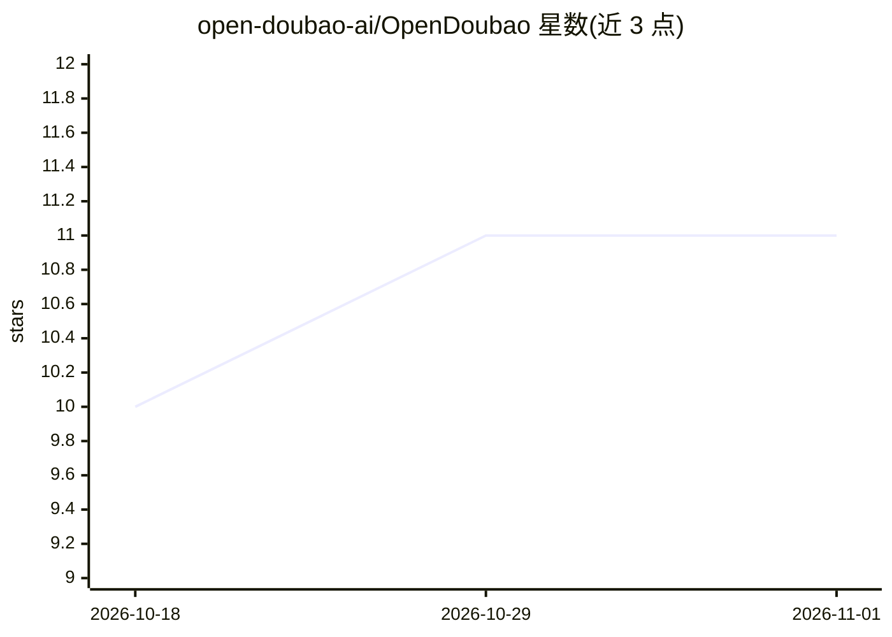

# open-doubao-ai/OpenDoubao

⭐ 11 · TypeScript · Apache-2.0 · 推送 2026-10-07 · [GitHub](https://github.com/open-doubao-ai/OpenDoubao) · 个人维护 · 中文 README

**聊天生成网页前后端的 Agent-to-API 引擎：稳态调用零 Token**

定位为豆包工作开源平替：AI Agent 通过聊天生成任务 UI 与 APIJSON 调用，绑定后筛选/排序/分页直接走 HTTP API，不再调用大语言模型。提供 A2API 0.1 协议（propose/bind 等信封）、HITL 审批机制（写与敏感读需管理员批准）、管理后台与内置意图规则（未配 LLM key 也可识别中英文意图）。需 Node.js 18+ 及本地运行的 APIJSONBoot 服务，执行 SQL 脚本初始化表。

## 筛选速览

| 维度 | 判定 | 备注 |
|---|---|---|
| AI 角色 | `ai-native` | 本体是模型或模型工具 |
| 许可风险 | `permissive` | Apache-2.0 |
| 部署形态 | `library` | 以包/库形式分发 |
| 模型依赖 | — | README 未给出锁定关系 |
| 硬件要求 | — | 无带数字的原话,不猜 |
| 安装摩擦 | `low` | 无编译、无系统依赖或容器化 |
| 成熟度 | — | 结构信号不足 |

## 能力要点

- Agent 生成 UI 后稳态调用不再耗 Token，`usedLlm: false`
- 写/敏感操作走 HITL 管理员审批，不走 SQL 执行路径
- A2API 0.1 协议：信封、JSON Pointer、校验器与 CRUD 夹具测试
- 无 OPENAI_API_KEY 时内置意图规则仍可识别中英文说法

## 适用场景

- 通过聊天快速生成数据任务的网页前后端
- 让非敏感查询以稳定 HTTP API 执行，节省模型调用成本
- 对写操作与敏感读操作做审批控制

## 场景标签

`聊天机器人` `Agent 框架` · 领域:Agent 开发

## 证据(README 行号)

> L3: # OpenDoubao - 豆包工作开源平替
> L7: Agent-to-API 协议、引擎与 Demo：生成任务 UI，之后改筛选/排序/分页直接调用 HTTP API，
> L63: 1. **生成(聊天 / AI 或规则)** — 生成 UI + 提出 APIJSON → 校验 → 执行至成功 → 发出 `bindRequest`

## 星数曲线

2026-10-18 10 → 2026-11-01 11（+1）

---
*卡片 v1 · prompt 1.4 · 生成 2026-11-01 · 置信度 high · 依据 README sha `a006b7c9b7a8` · [字段定义](../../DATASET.md)*
