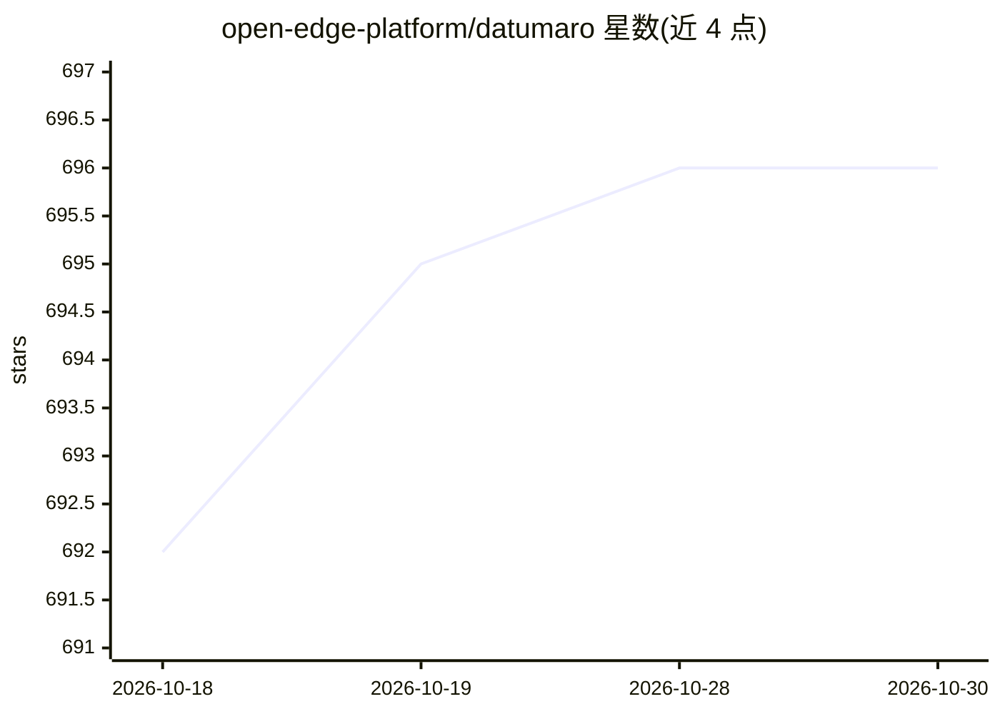

# open-edge-platform/datumaro

⭐ 696 · Python · MIT · 推送 2026-10-28 · [GitHub](https://github.com/open-edge-platform/datumaro) · [官网](https://open-edge-platform.github.io/datumaro) · 组织维护

**构建、转换、分析计算机视觉数据集的 Python 库与 CLI**

Dataset Management Framework (Datumaro) 是一个 Python 库加 CLI 工具，用于读取、写入与双向转换计算机视觉数据集，支持 VOC、COCO、ImageNet、YOLO、MNIST、CVAT 等多种格式。提供数据集合并、按自定义条件过滤、标注类型转换、train/val/test 划分（含按任务保持标签分布的划分）、数据集质量检查、与模型推理结果比对、数据集比较与统计（图像均值/方差、标注统计）等功能。以 pip 包与源码方式提供，面向构建模型训练流水线的开发者和团队。

## 筛选速览

| 维度 | 判定 | 备注 |
|---|---|---|
| AI 角色 | `ai-ecosystem` | LLM/agent 周边工具 |
| 许可风险 | `permissive` | MIT |
| 部署形态 | `None` |  |
| 模型依赖 | — | README 未给出锁定关系 |
| 硬件要求 | — | 无带数字的原话,不猜 |
| 安装摩擦 | `low` | 无编译、无系统依赖或容器化 |
| 成熟度 | — | 结构信号不足 |

## 能力要点

- 多种 CV 数据集格式（COCO/VOC/YOLO/ImageNet/CVAT 等）任意方向读取与转换
- 数据集合并、过滤、标注转换与按任务的子集划分
- 数据集质量检查、与模型推理比对、多数据集比较
- 数据集统计输出（图像 mean/std、标注统计）

## 适用场景

- 把不同标注工具导出的数据集统一转换为训练所需格式
- 训练前对数据集做质量检查与错误排查
- 将多个数据集合并并按标签分布划分 train/val/test

## 场景标签

 · 领域:计算机视觉/数据工程

## 证据(README 行号)

> L8: A framework and CLI tool to build, transform, and analyze datasets.
> L13: COCO dataset -----> Datumaro ---> dataset ------> Model training

## 星数曲线

2026-10-18 692 → 2026-10-30 696（+4）

---
*卡片 v1 · prompt 1.4 · 生成 2026-10-21 · 置信度 high · 依据 README sha `fc3c262eabbc` · [字段定义](../../DATASET.md)*
