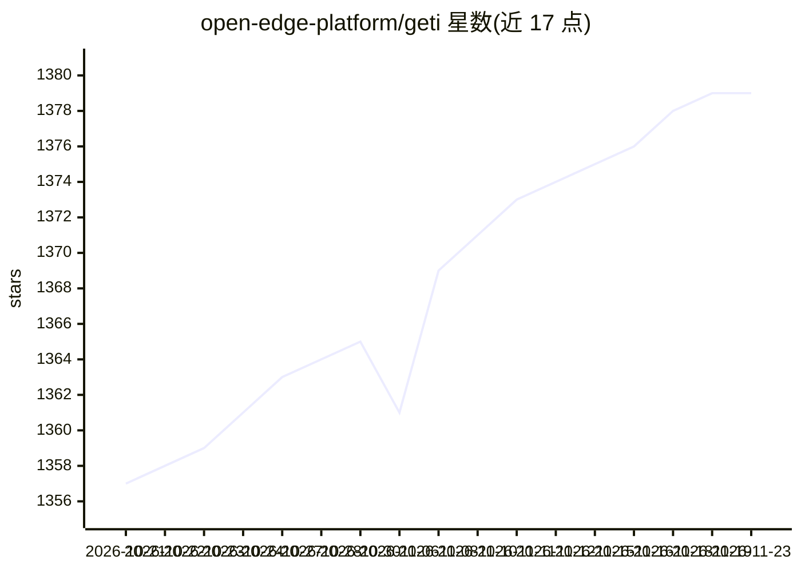

# open-edge-platform/geti

⭐ 1,379 · Python · Apache-2.0 · 推送 2026-11-22 · [GitHub](https://github.com/open-edge-platform/geti) · [官网](https://docs.geti.intel.com) · 组织维护

**为开发者与企业提供从标注到部署的本地计算机视觉模型训练平台**

Geti 是开源的端到端计算机视觉平台，覆盖标注、微调、优化、部署与推理，提供 1,600+ 模型变体用于检测、分类与分割，并经 OpenVINO 针对 Intel CPU/GPU/NPU 优化。使用方式有二：面向无代码体验的 Geti 应用（Windows 原生程序、Docker 镜像或源码运行），以及 PyPI 上的独立 Python 库 getitune（代码优先工作流）。内置准确性感知的 INT8 量化，可在无 Kubernetes 集群或数据中心 GPU 的边缘/客户端硬件上运行；Ultralytics YOLO 模型因 AGPL-3.0 许可默认不包含，需通过 extra 指定安装。

## 筛选速览

| 维度 | 判定 | 备注 |
|---|---|---|
| AI 角色 | `ai-native` | 本体是模型或模型工具 |
| 许可风险 | `permissive` | Apache-2.0 |
| 部署形态 | `library` | 以包/库形式分发 |
| 模型依赖 | local-ok | 支持本地模型 |
| 硬件要求 | `cpu-ok` | |
| 安装摩擦 | `medium` | 含编译或系统依赖之一 |
| 成熟度 | — | 结构信号不足 |

## 能力要点

- 支持目标检测、实例分割与图像分类训练，模型目录含 RF-DETR、DINOv3 DETR、YOLO 系列、ConvNeXt 等，另有 timm 1,600+ backbone
- 应用与 getitune Python 库两条路径：无代码界面或代码优先 API
- 模型自动导出 OpenVINO，支持 Intel XPU、NVIDIA CUDA 与 CPU-only，内置准确性感知 INT8 量化
- 自定义推理管线（source→model→sink）支持 USB/IP 摄像头与视频流，可导出 OpenVINO 优化包，sink 支持文件夹/MQTT/webhook

## 适用场景

- 用 10-20 张图片起步训练检测或分割模型并部署到边缘设备
- 通过 AI 辅助标注（含 Segment Anything Model）加速数据标注
- 在本地 Windows 或 Linux 容器中构建持续改进的视觉模型
- 导出 INT8 量化模型到资源受限设备

## 场景标签

`目标检测` `微调` `模型量化` · 领域:感知与多模态

## 证据(README 行号)

> L14: **_Geti™_** is an open-source, end-to-end platform for building and continuously improving your own computer vision
> L18: The Geti™ application is powered by **_getitune_**, its engine for model training and optimization, which is also a
> L184: Every model is automatically exported with OpenVINO™ for deployment across the full Intel® XPU portfolio (Arc™ GPU

## 星数曲线

2026-10-21 1,357 → 2026-11-23 1,379（+22）

---
*卡片 v1 · prompt 1.4 · 生成 2026-11-23 · 置信度 high · 依据 README sha `bc9f5e236e52` · [字段定义](../../DATASET.md)*
