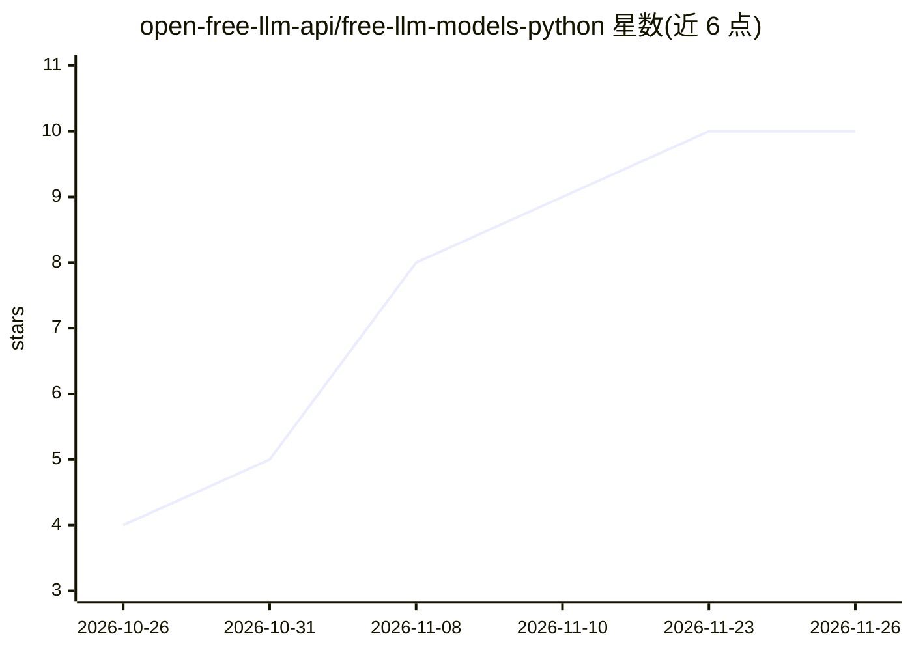

# open-free-llm-api/free-llm-models-python

⭐ 10 · Python · 推送 2026-10-18 · [GitHub](https://github.com/open-free-llm-api/free-llm-models-python) · [官网](https://freellm.net) · 组织维护

**免费 LLM API 目录库：Python/CLI 查询 537+ 模型数据**

以 Python 包与 CLI 形式提供免费 LLM API 的机器可读目录：数据每日从 freellm.net 同步，覆盖 30+ 个 provider 的 537 个模型，字段含 id、名称、provider、是否支持 function calling 与 JSON mode、发布日期。用户可在终端用 free-llm-models list 命令查询，或在 Python 中 import 搜索模型；另有 npm 同名包与 awesome-freellm-apis 清单为同一数据的互补形态，均由同一组织维护。

## 筛选速览

| 维度 | 判定 | 备注 |
|---|---|---|
| AI 角色 | `ai-knowledge` | 知识聚合/清单类 |
| 许可风险 | `permissive` | — |
| 部署形态 | `library` | 以包/库形式分发 |
| 模型依赖 | — | README 未给出锁定关系 |
| 硬件要求 | — | 无带数字的原话,不猜 |
| 安装摩擦 | `low` | 无编译、无系统依赖或容器化 |
| 成熟度 | — | 结构信号不足 |

## 能力要点

- 537 个免费 LLM 模型、30+ provider，每日从 freellm.net 同步
- CLI 命令与 Python import 两种查询方式
- 机器可读字段含 function calling / JSON mode 支持情况
- 提供 npm 同名包与 awesome-freellm-apis 互补清单

## 适用场景

- 在写代码前快速筛选有哪些免费 LLM API 可接入
- 按支持 function calling / JSON mode 等字段过滤模型
- 在 Python 项目中直接查询模型目录数据

## 场景标签

 · 领域:LLM 资源目录/数据聚合

## 证据(README 行号)

> L10: A curated, machine-readable directory of **537+ free LLM APIs and models** from 30+ providers. Query it from your t
> L12: Data is synced daily from FreeLLM — the free LLM API directory with live playground. Browse the full interactive ca
> L51: - **537 models** across 30+ providers

## 星数曲线

2026-10-26 4 → 2026-11-26 10（+6）

---
*卡片 v1 · prompt 1.4 · 生成 2026-11-20 · 置信度 high · 依据 README sha `3b9c9263e1e6` · [字段定义](../../DATASET.md)*
