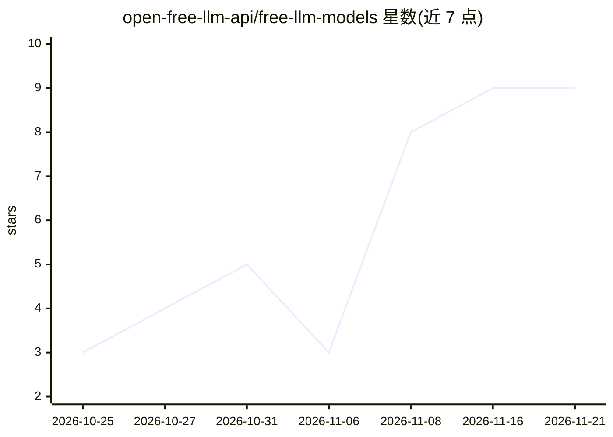

# open-free-llm-api/free-llm-models

⭐ 9 · JavaScript · 推送 2026-10-18 · [GitHub](https://github.com/open-free-llm-api/free-llm-models) · [官网](https://freellm.net) · 组织维护

**查询免费 LLM API 目录的 CLI 与 Node.js 数据包**

机器可读的免费 LLM API 目录，收录 30+ 提供商的 537+ 个免费模型，数据每日从 freellm.net 同步。提供 CLI（list/search 等子命令）与 Node.js require 导入两种查询方式，字段含模型 id、名称、提供商、function calling/JSON 模式支持与发布日期。另提供 PyPI 同名 Python 包；同一数据集还以 awesome-freellm-apis 清单形式维护，二者同属 open-free-llm-api 组织。

## 筛选速览

| 维度 | 判定 | 备注 |
|---|---|---|
| AI 角色 | `ai-knowledge` | 知识聚合/清单类 |
| 许可风险 | `permissive` | — |
| 部署形态 | `library` | 以包/库形式分发 |
| 模型依赖 | — | README 未给出锁定关系 |
| 硬件要求 | — | 无带数字的原话,不猜 |
| 安装摩擦 | `low` | 无编译、无系统依赖或容器化 |
| 成熟度 | — | 结构信号不足 |

## 能力要点

- 收录 30+ 提供商的 537+ 个免费 LLM 模型条目
- CLI 查询与 Node.js require 程序化调用两种方式
- 字段含 function calling/JSON 模式支持标记与发布日期
- 提供 PyPI 同名 Python 包，数据每日同步

## 适用场景

- 在终端里检索当前有哪些免费可用的 LLM API
- 在 Node.js 项目中程序化读取免费模型目录数据
- 查询某模型是否支持 function calling 或 JSON 模式

## 场景标签

 · 领域:LLM 基础设施/目录与数据集

## 证据(README 行号)

> L10: A curated, machine-readable directory of **537+ free LLM APIs and models** from 30+ providers. Query it from your t
> L12: Data is synced daily from FreeLLM — the free LLM API directory with live playground. Browse the full interactive ca

## 星数曲线

2026-10-25 3 → 2026-11-21 9（+6）

---
*卡片 v1 · prompt 1.4 · 生成 2026-11-20 · 置信度 mid · 依据 README sha `846e73d6ffb0` · [字段定义](../../DATASET.md)*
