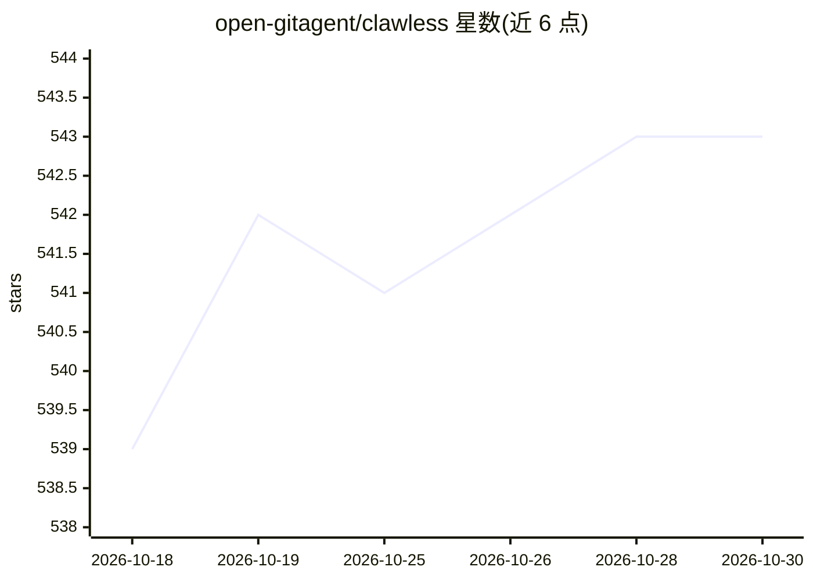

# open-gitagent/clawless

⭐ 543 · TypeScript · MIT · 推送 2026-07-08 · [GitHub](https://github.com/open-gitagent/clawless) · [官网](https://play.clawless.io) · 组织维护

**浏览器内运行 Claw AI Agent 的无服务器沙箱运行时**

基于 WebContainers（WASM）在浏览器中提供完整 Node.js 沙箱环境来运行 Claw AI Agent，无需后端服务器。内置 Monaco 编辑器、xterm.js 终端、YAML 策略引擎（文件/进程/网络/运行限制）与端到端审计日志（API key 自动脱敏）。支持 Anthropic/OpenAI/Google 多模型接入，插件系统与模板化 Agent 引导，运行时状态持久化到 localStorage。以 npm 包 clawcontainer 提供 SDK，也可源码运行。沙箱完全隔离，无宿主系统访问。

## 筛选速览

| 维度 | 判定 | 备注 |
|---|---|---|
| AI 角色 | `ai-ecosystem` | LLM/agent 周边工具 |
| 许可风险 | `permissive` | MIT |
| 部署形态 | `library` | 以包/库形式分发 |
| 模型依赖 | locked-api |  |
| 硬件要求 | — | 无带数字的原话,不猜 |
| 安装摩擦 | `low` | 无编译、无系统依赖或容器化 |
| 成熟度 | — | 结构信号不足 |

## 能力要点

- WebContainers (WASM) 浏览器内完整 Node.js 沙箱，无需服务器
- YAML 策略引擎在容器层强制执行文件/进程/网络守卫规则
- 端到端审计日志，API key 自动脱敏，可下载完整日志
- Anthropic/OpenAI/Google 多模型接入与插件生命周期钩子

## 适用场景

- 在浏览器中安全地运行和观察 AI Agent 的行为
- 为 Agent 执行设置策略守卫并做合规审计
- 通过 SDK 将沙箱化 Agent 运行时嵌入自己的应用

## 场景标签

`Agent 框架` · 领域:Agent 开发

## 证据(README 行号)

> L5:  A serverless browser-based runtime for Claw AI Agents powered by WebContainers
> L29: Run, observe, and control AI agents entirely in the browser — no backend required. ClawLess provides a full sandbox

## 星数曲线

2026-10-18 539 → 2026-10-30 543（+4）

---
*卡片 v1 · prompt 1.4 · 生成 2026-10-21 · 置信度 high · 依据 README sha `3e398f61febc` · [字段定义](../../DATASET.md)*
