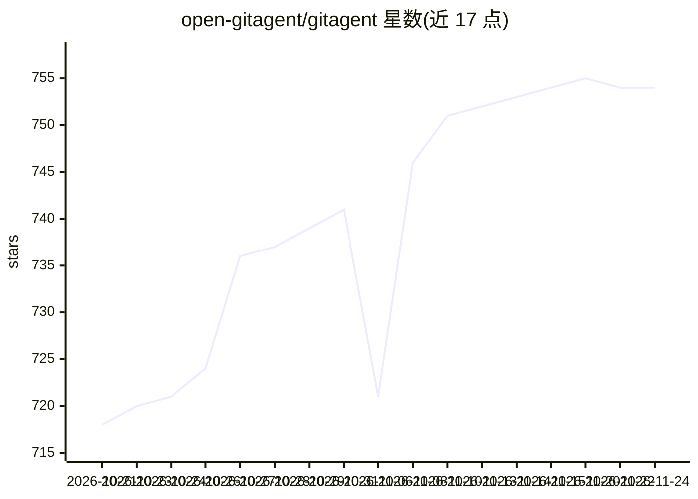

# open-gitagent/gitagent

⭐ 754 · Rust · MIT · 推送 2026-11-08 · [GitHub](https://github.com/open-gitagent/gitagent) · 组织维护

**以 git 仓库承载 agent 身份、记忆与技能的 agent 框架**

gitagent 是一个 git-native 的 AI agent 框架：agent 的身份（SOUL.md）、规则、记忆、技能、工具与调度全部以仓库内版本控制的文件定义。Rust 编写的单一静态二进制，提供终端控制台、CLI、并行子 agent 任务板，以及 Python/TypeSDK（IPC 行协议）。支持 Anthropic/OpenAI/Gemini 及任意 OpenAI 兼容端点，repo 模式下在新分支上执行任务并提交结果。安装方式为 shell 脚本、npm 或从源码构建（需 Rust）。

## 筛选速览

| 维度 | 判定 | 备注 |
|---|---|---|
| AI 角色 | `ai-ecosystem` | LLM/agent 周边工具 |
| 许可风险 | `permissive` | MIT |
| 部署形态 | `library` | 以包/库形式分发 |
| 模型依赖 | local-ok | 支持本地模型 |
| 硬件要求 | — | 无带数字的原话,不猜 |
| 安装摩擦 | `medium` | 含编译或系统依赖之一 |
| 成熟度 | — | 结构信号不足 |

## 能力要点

- agent 定义全部为 git 版本控制的文件（agent.yaml/SOUL.md/RULES.md/memory 等）
- 单一静态二进制，无需安装运行时；提供 Python/TypeScript SDK
- 并行子 agent 任务板与基于 cron 的 schedules 调度
- 模型接入覆盖 Anthropic/OpenAI/Gemini 及 OpenAI 兼容端点（含 Ollama/vLLM 默认端点）

## 适用场景

- 把 agent 的人设、规则与记忆纳入 git 审查与回滚
- 让 agent 在仓库新分支上完成任务并提交改动
- 用 cron 定时让 agent 执行例行任务

## 场景标签

`Agent 框架` · 领域:Agent 开发

## 证据(README 行号)

> L29: Most agent frameworks treat the agent as code scattered across your application. gitagent flips this: **your agent 
> L42: **gitagent 3** is the Rust rewrite: one static binary with no runtime to install, the harness that scored 93.03% on
> L42: **gitagent 3** is the Rust rewrite: one static binary with no runtime to install, the harness that scored 93.03% on

## 星数曲线

2026-10-21 718 → 2026-11-24 754（+36）

---
*卡片 v1 · prompt 1.4 · 生成 2026-11-24 · 置信度 mid · 依据 README sha `b56672af9bab` · [字段定义](../../DATASET.md)*
