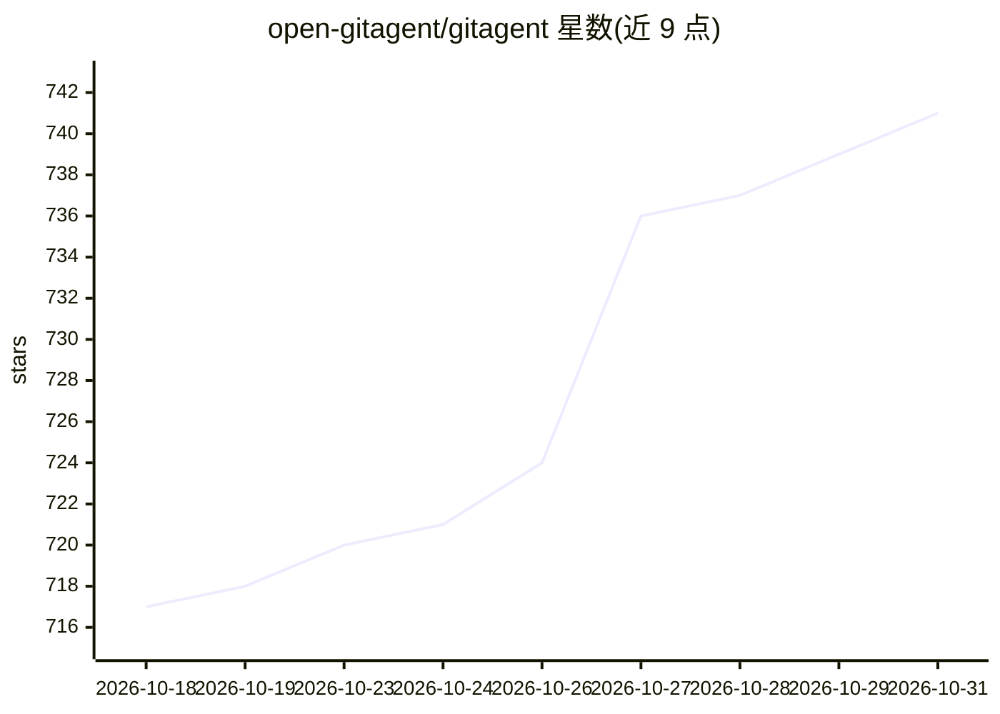

# open-gitagent/gitagent

⭐ 741 · Rust · MIT · 推送 2026-10-30 · [GitHub](https://github.com/open-gitagent/gitagent) · 组织维护

**git 原生 AI Agent 框架：以仓库形式管理 agent 身份与记忆**

TypeScript 实现的通用 agent 框架，核心机制是『agent 即 git 仓库』：agent.yaml 定义模型与运行时配置，SOUL.md/RULES.md 定义身份与约束，memory/ 目录以 git 提交方式保存带历史的记忆，tools/ 为 YAML 声明式工具，skills/hooks/plugins 可组合扩展。提供 CLI、进程内 SDK 与浏览器语音 UI；作为 MCP 客户端可自动发现外部 MCP 服务器工具，支持 anthropic/openai/google/xai/groq/mistral 等多提供商及 fallback 链。内置合规校验与审计日志（.gitagent/audit.jsonl）。需 Node.js 18+ 与 git，通过 npm 或一键脚本安装。

## 筛选速览

| 维度 | 判定 | 备注 |
|---|---|---|
| AI 角色 | `ai-ecosystem` | LLM/agent 周边工具 |
| 许可风险 | `permissive` | MIT |
| 部署形态 | `self-host` | docker 或自建部署 |
| 模型依赖 | locked-api |  |
| 硬件要求 | — | 无带数字的原话,不猜 |
| 安装摩擦 | `low` | 无编译、无系统依赖或容器化 |
| 成熟度 | — | 结构信号不足 |

## 能力要点

- agent 身份、规则、记忆、工具、技能全部为 git 版本化文件
- MCP 客户端：自动发现并注册任意 MCP 服务器工具
- 多模型支持：preferred/fallback 模型链，支持 anthropic/openai/google/xai/groq/mistral 等
- 进程内 SDK（query/tool/hooks API），无子进程与 IPC
- 插件体系与 agent 继承（extends 远程 base agent）

## 适用场景

- 用 git 分支、diff、log 管理 agent 的人格与记忆演进
- 克隆 GitHub 仓库让 agent 在会话分支上执行修复、测试等任务
- 通过 MCP 服务器为 agent 接入 filesystem/GitHub/Postgres 等工具
- 以 SDK 将可审计的 agent 嵌入自己的程序

## 场景标签

`Agent 框架` `Agent 记忆` · 领域:Agent 开发

## 证据(README 行号)

> L24: Most agent frameworks treat configuration as code scattered across your application. Gitagent flips this — **your a
> L141: The SDK provides a programmatic interface to Gitagent agents. It mirrors the Claude Agent SDK pattern but runs **i
> L414: Gitagent works with any LLM provider supported by pi-ai:

## 星数曲线

2026-10-18 717 → 2026-10-31 741（+24）

---
*卡片 v1 · prompt 1.4 · 生成 2026-10-22 · 置信度 mid · 依据 README sha `1731cea13c9f` · [字段定义](../../DATASET.md)*
