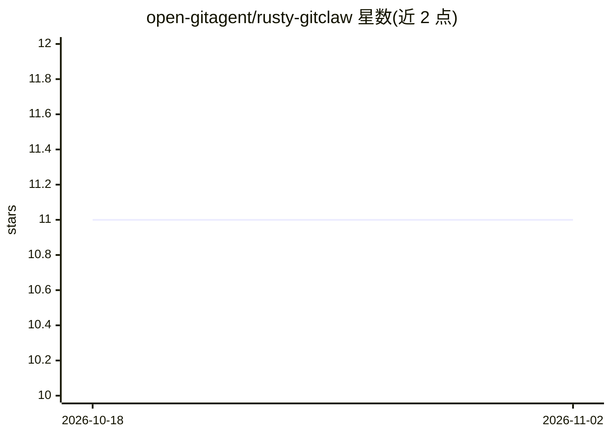

# open-gitagent/rusty-gitclaw

⭐ 11 · Rust · MIT · 推送 2026-03-05 · [GitHub](https://github.com/open-gitagent/rusty-gitclaw) · [官网](https://github.com/open-gitagent/gitclaw) · 组织维护

**git 原生 AI agent 框架：agent 以仓库形式定义与版本化**

GitClaw 的 Rust 移植版，采用 agent-as-a-repo 设计：agent 的模型配置、人格（SOUL.md）、规则、记忆、工具与技能均为 git 版本化文件。编译为单一 12MB 二进制，无运行时依赖。内置 383 个模型注册表，覆盖 8 家 provider（Anthropic/OpenAI/Google/xAI/Groq/Mistral/OpenRouter/Cerebras），支持模型回退链、声明式 YAML 工具、脚本 hooks、可组合技能模块、语音模式（OpenAI Realtime API）与审计日志。提供 CLI 与 Rust SDK，支持从源码 cargo 安装或下载预编译二进制；crates.io 发布标注 coming soon。

## 筛选速览

| 维度 | 判定 | 备注 |
|---|---|---|
| AI 角色 | `ai-ecosystem` | LLM/agent 周边工具 |
| 许可风险 | `permissive` | MIT |
| 部署形态 | `library` | 以包/库形式分发 |
| 模型依赖 | locked-api |  |
| 硬件要求 | — | 无带数字的原话,不猜 |
| 安装摩擦 | `low` | 无编译、无系统依赖或容器化 |
| 成熟度 | `idea` | |

## 能力要点

- agent 配置/记忆/工具/技能全部为 git 版本化文件
- 单一 12MB Rust 二进制，无运行时依赖
- 383 模型注册表、8 家 provider 与 fallback 链
- 内置 cli/read/write/memory 工具及 hooks、skills、审计日志机制

## 适用场景

- 在代码仓库上运行 agent 执行修复、写测试等任务
- 以分支/fork 方式管理多个 agent 人格与规则
- 通过 Rust SDK 将 agent 循环嵌入自己的项目

## 场景标签

`Agent 框架` `编码 Agent` · 领域:Agent 开发

## 证据(README 行号)

> L11:  A universal git-native AI agent framework — written in Rust.
> L167: └── gitclaw/            # CLI + SDK + tools + voice

## 星数曲线

2026-10-18 11 → 2026-11-02 11（+0）

---
*卡片 v1 · prompt 1.4 · 生成 2026-11-01 · 置信度 mid · 依据 README sha `a09a00977302` · [字段定义](../../DATASET.md)*
