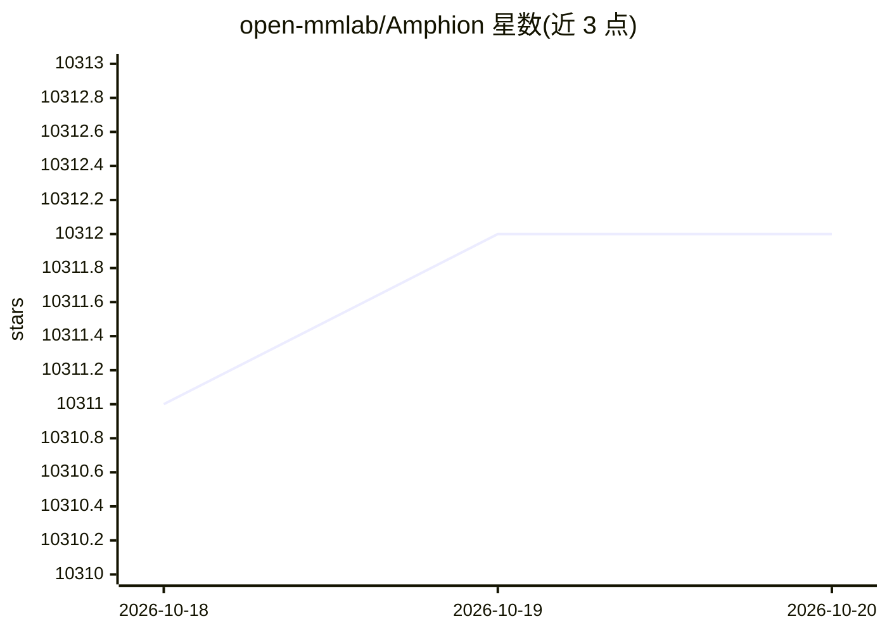

# open-mmlab/Amphion

⭐ 10,312 · Python · MIT · 推送 2026-03-25 · [GitHub](https://github.com/open-mmlab/Amphion) · [官网](https://openhlt.github.io/amphion/) · 组织维护

**音频/音乐/语音生成工具包，面向科研与工程的复现平台**

open-mmlab 维护的开源工具包，支持 TTS、歌声合成、语音/歌声转换、口音转换、文本转音频等生成任务，实现 FastSpeech2、VITS、VALL-E、MaskGCT、Vevo 系列等模型架构，并包含多种神经声码器（HiFi-GAN、BigVGAN 等）、客观评测指标（FAD、MCD、PESQ 等）、数据集预处理与可视化工具 SingVisio。附带 Emilia 数据集与 Emilia-Pipe 预处理管线。提供源码安装与 Docker 镜像两种方式，面向研究人员与工程师。

## 筛选速览

| 维度 | 判定 | 备注 |
|---|---|---|
| AI 角色 | `ai-native` | 本体是模型或模型工具 |
| 许可风险 | `permissive` | MIT |
| 部署形态 | `self-host` | docker 或自建部署 |
| 模型依赖 | — | README 未给出锁定关系 |
| 硬件要求 | — | 无带数字的原话,不猜 |
| 安装摩擦 | `low` | 无编译、无系统依赖或容器化 |
| 成熟度 | — | 结构信号不足 |

## 能力要点

- 覆盖 TTS/VC/AC/SVC/SVS/TTA 六类生成任务，含数十种模型架构实现
- 提供 FAD、MCD、PESQ、STOI 等客观评测指标计算
- 包含多种神经声码器实现与 Multi-Scale CQT 判别器
- Emilia 数据集（101k/200k+ 小时）与 Emilia-Pipe 预处理管线

## 适用场景

- 复现和训练语音合成、语音转换等生成模型
- 对比评测音频生成结果的客观指标
- 为语音生成研究构建大规模训练数据

## 场景标签

`语音合成` `科研工具` · 领域:内容生成

## 证据(README 行号)

> L7: **Amphion (/æmˈfaɪən/) is a toolkit for Audio, Music, and Speech Generation.** Its purpose is to support reproducibl
> L9: **The North-Star objective of Amphion is to offer a platform for studying the conversion of any inputs into audio.**

## 星数曲线

2026-10-18 10,311 → 2026-10-20 10,312（+1）

---
*卡片 v1 · prompt 1.4 · 生成 2026-10-20 · 置信度 high · 依据 README sha `bb3b072050f8` · [字段定义](../../DATASET.md)*
