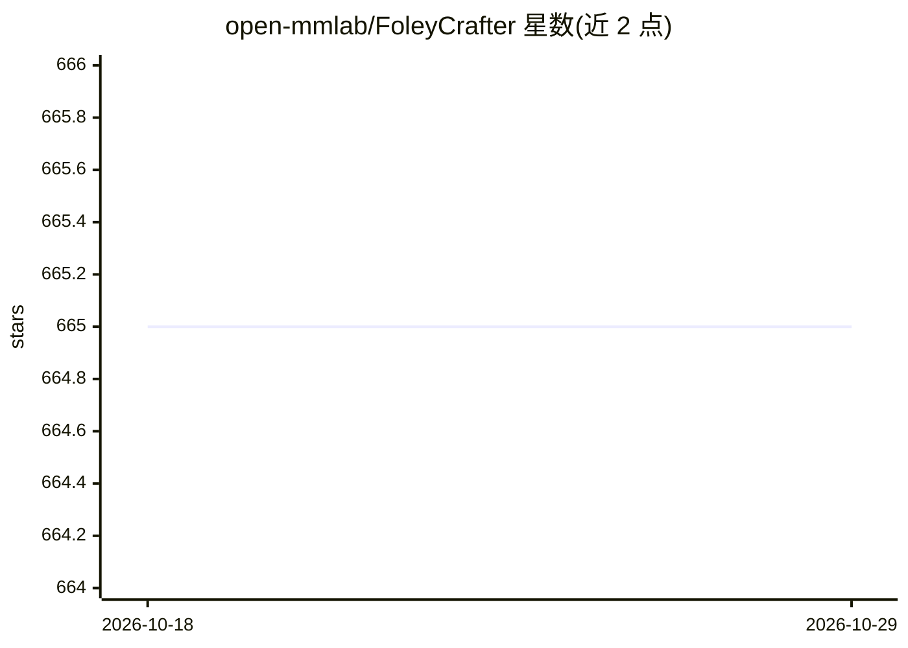

# open-mmlab/FoleyCrafter

⭐ 665 · Python · Apache-2.0 · 推送 2026-06-15 · [GitHub](https://github.com/open-mmlab/FoleyCrafter) · [官网](https://foleycrafter.github.io/) · 组织维护 · 中文 README

**为无声视频生成语义相关且同步音效的 video-to-audio 框架**

FoleyCrafter 是视频转音频生成框架，基于扩散模型的文本到音频基座 Auffusion，结合语义适配器与时间对齐模块，为无声视频生成语义相关并与画面同步的音效；支持提示词与负向提示词控制生成内容，并可通过 --temporal_align 参数进行视觉线索的时间对齐。以 conda 环境安装的 Python 源码形式提供，含 inference.py 命令行推理与 Gradio 网页界面，checkpoint 可由脚本自动下载或手动从 HuggingFace 获取。面向 AIGC 与音效合成研究及开发用户。

## 筛选速览

| 维度 | 判定 | 备注 |
|---|---|---|
| AI 角色 | `ai-native` | 本体是模型或模型工具 |
| 许可风险 | `permissive` | Apache-2.0 |
| 部署形态 | `None` |  |
| 模型依赖 | — | README 未给出锁定关系 |
| 硬件要求 | — | 无带数字的原话,不猜 |
| 安装摩擦 | `low` | 无编译、无系统依赖或容器化 |
| 成熟度 | — | 结构信号不足 |

## 能力要点

- video-to-audio 生成：音效与视频语义相关且同步
- 基于 Auffusion 文本到音频基座与扩散模型
- 支持提示词/负向提示词控制与时间对齐（--temporal_align）
- 提供 Gradio 网页界面与命令行推理两种使用方式

## 适用场景

- 给无声视频自动配生成音效
- 通过提示词或负向提示词控制生成音效的内容
- 在本地用 Gradio 界面交互式试用模型

## 场景标签

 · 领域:生成式 AI/音视频合成

## 证据(README 行号)

> L11: Sound effects are the unsung heroes of cinema and gaming, enhancing realism, impact, and emotional depth for an imm
> L44:  Download the text-to-audio base model. We use Auffusion
> L75: python inference.py --save_dir=output/sora/

## 星数曲线

2026-10-18 665 → 2026-10-29 665（+0）

---
*卡片 v1 · prompt 1.4 · 生成 2026-10-21 · 置信度 high · 依据 README sha `57bd903ff815` · [字段定义](../../DATASET.md)*
