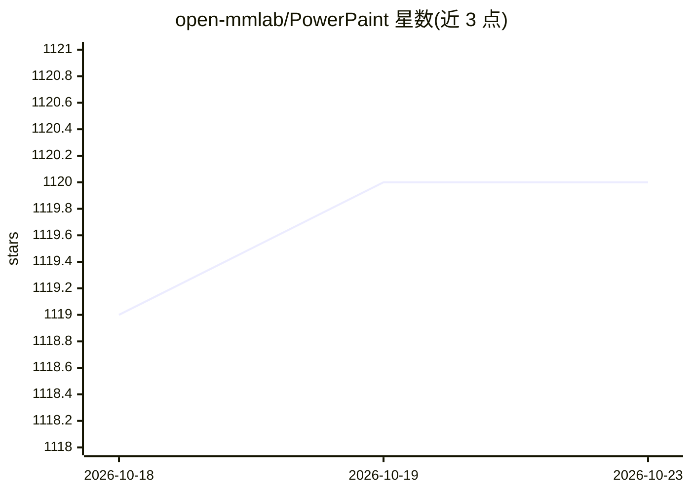

# open-mmlab/PowerPaint

⭐ 1,120 · Python · MIT · 推送 2026-08-15 · [GitHub](https://github.com/open-mmlab/PowerPaint) · [官网](https://powerpaint.github.io/) · 组织维护 · 中文 README

**单模型图像修补：插入/移除物体、外扩、形状可控生成**

ECCV 2024 论文『A Task is Worth One Word』对应的图像修补模型，基于为不同修补任务定制任务提示词（task prompts）的学习方式，用一个模型同时支持文本引导物体插入、物体移除、图像外扩与形状引导生成。兼容 ControlNet（Canny/Depth/HED/Pose），形状引导可通过 fitting degree 滑杆控制生成物体与掩码形状的贴合度，训练细节在 dev 分支。提供 Gradio 界面推理，模型权重托管在 Hugging Face，含 v2 与 v2-1 版本。

## 筛选速览

| 维度 | 判定 | 备注 |
|---|---|---|
| AI 角色 | `ai-native` | 本体是模型或模型工具 |
| 许可风险 | `permissive` | MIT |
| 部署形态 | `None` |  |
| 模型依赖 | — | README 未给出锁定关系 |
| 硬件要求 | — | 无带数字的原话,不猜 |
| 安装摩擦 | `low` | 无编译、无系统依赖或容器化 |
| 成熟度 | — | 结构信号不足 |

## 能力要点

- 单模型支持四类修补任务（插入/移除/外扩/形状引导）
- 兼容 ControlNet 条件控制（Canny/Depth/HED/Pose）
- fitting degree 可调的形状引导生成
- v2-1 权重已开源，提供 Gradio 界面

## 适用场景

- 上传图片并画掩码，用文字提示插入指定物体
- 移除图中不需要的物体并按背景填充
- 按比例扩展图像边界（outpainting）
- 通过掩码形状约束生成物体的轮廓

## 场景标签

`图像生成` · 领域:内容生成

## 证据(README 行号)

> L16: PowerPaint is a high-quality versatile image inpainting model that supports text-guided object inpainting, object r
> L33: ||Object insertion|Object Removal|Shape-guided Object Insertion|Outpainting|

## 星数曲线

2026-10-18 1,119 → 2026-10-23 1,120（+1）

---
*卡片 v1 · prompt 1.4 · 生成 2026-10-21 · 置信度 high · 依据 README sha `fd02655d4e1e` · [字段定义](../../DATASET.md)*
