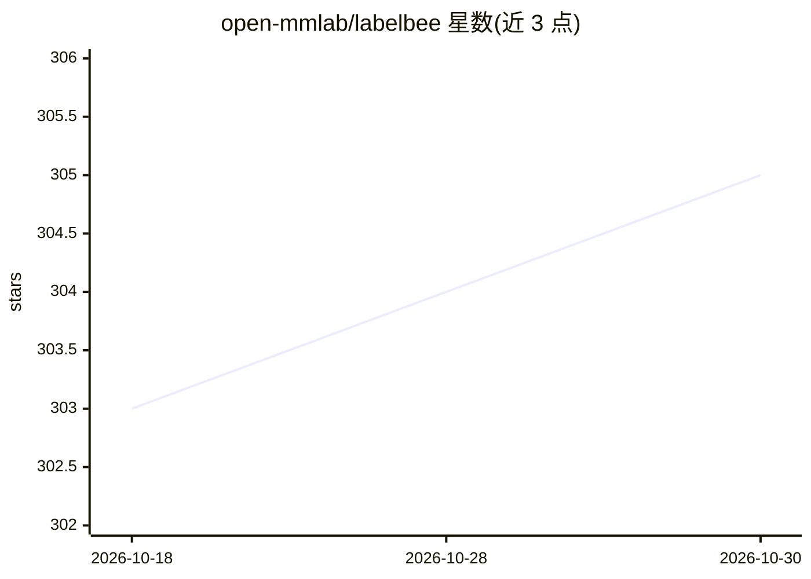

# open-mmlab/labelbee

⭐ 305 · TypeScript · Apache-2.0 · 推送 2026-07-21 · [GitHub](https://github.com/open-mmlab/labelbee) · 组织维护 · 中文 README

**前端标注渲染与组件库，用于快速搭建数据标注应用**

OpenMMLab 维护的标注场景前端库，分为 lb-annotation 渲染库与 lb-components 组件库两个 npm 包：通过简单配置即可创建标注应用，渲染与组件分离，渲染模块可单独使用。以 React 组件方式集成（如 AnnotationView），面向需要自建标注工具的开发者。README 未列出具体标注类型与 AI 相关功能，另有桌面端 LabelBee-Client 的友情链接。Apache 2.0 许可。

## 筛选速览

| 维度 | 判定 | 备注 |
|---|---|---|
| AI 角色 | `ai-ecosystem` | LLM/agent 周边工具 |
| 许可风险 | `permissive` | Apache-2.0 |
| 部署形态 | `library` | 以包/库形式分发 |
| 模型依赖 | — | README 未给出锁定关系 |
| 硬件要求 | — | 无带数字的原话,不猜 |
| 安装摩擦 | `low` | 无编译、无系统依赖或容器化 |
| 成熟度 | — | 结构信号不足 |

## 能力要点

- 拆分为渲染库与组件库两个 npm 包
- 渲染与组件分离，渲染模块可单独使用
- 简单配置即可创建标注应用

## 适用场景

- 在前端项目中快速搭建图像标注应用
- 复用标注渲染模块嵌入现有系统

## 场景标签

 · 领域:前端开发/数据标注工具

## 证据(README 行号)

> L4:  为标注而生，专注于标注体验的渲染、组件库。快速搭建标注应用。
> L10: - 即拆即用，简单配置即可创建标注应用

## 星数曲线

2026-10-18 303 → 2026-10-30 305（+2）

---
*卡片 v1 · prompt 1.4 · 生成 2026-10-21 · 置信度 low · 依据 README sha `26e22c4cb080` · [字段定义](../../DATASET.md)*
