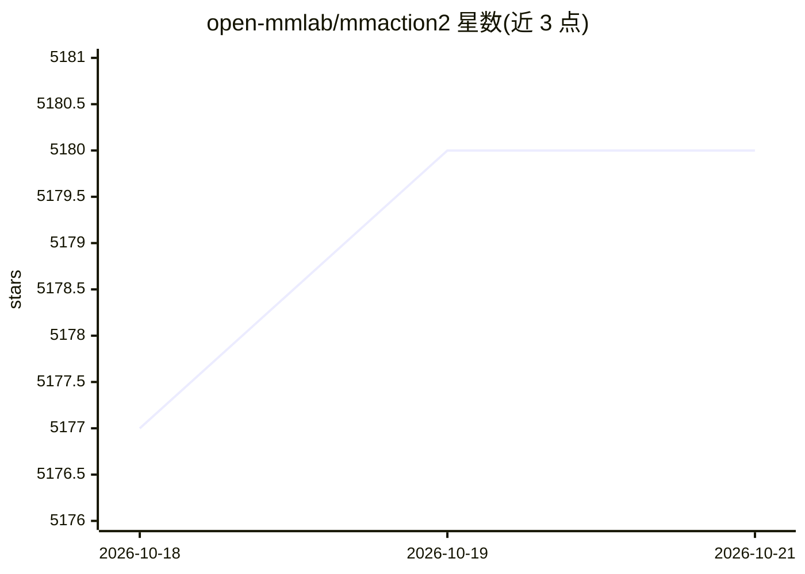

# open-mmlab/mmaction2

⭐ 5,180 · Python · Apache-2.0 · 推送 2026-03-18 · [GitHub](https://github.com/open-mmlab/mmaction2) · [官网](https://mmaction2.readthedocs.io) · 组织维护 · 中文 README

**基于 PyTorch 的视频理解工具箱：行为识别/定位/检测/检索**

OpenMMLab 视频理解工具箱，覆盖行为识别、时序行为定位、时空行为检测、骨架行为识别与视频检索五类任务，实现 C3D/TSN/I3D/SlowFast/TimeSformer/PoseC3D 等数十种算法及配套模型库，支持 Kinetics、AVA、HMDB51 等多种数据集。组件模块化设计，可组合构建定制框架，提供训练/测试/推理教程与单元测试。面向视频理解研究者的复现与开发工具，依赖 PyTorch/MMCV/MMEngine，MMDetection 与 MMPose 为可选依赖。Apache 2.0 许可。

## 筛选速览

| 维度 | 判定 | 备注 |
|---|---|---|
| AI 角色 | `ai-native` | 本体是模型或模型工具 |
| 许可风险 | `permissive` | Apache-2.0 |
| 部署形态 | `library` | 以包/库形式分发 |
| 模型依赖 | — | README 未给出锁定关系 |
| 硬件要求 | — | 无带数字的原话,不猜 |
| 安装摩擦 | `low` | 无编译、无系统依赖或容器化 |
| 成熟度 | — | 结构信号不足 |

## 能力要点

- 支持五类视频理解任务（识别/定位/时空检测/骨架识别/检索）
- 收录 C3D 至 VideoMAE V2 等数十种算法模型
- 模块化设计可组合构建定制框架
- 提供模型库与详细文档、API 参考和单元测试

## 适用场景

- 在 Kinetics/AVA 等数据集上训练或复现视频行为识别模型
- 使用现有模型做视频行为识别与时空行为检测推理
- 基于模块组合构建自定义视频理解框架

## 场景标签

`目标检测` `语义搜索` · 领域:知识与检索

## 证据(README 行号)

> L69: MMAction2 is an open-source toolbox for video understanding based on PyTorch.
> L82: - **Support five major video understanding tasks**: MMAction2 implements various algorithms for multiple video unde

## 星数曲线

2026-10-18 5,177 → 2026-10-21 5,180（+3）

---
*卡片 v1 · prompt 1.4 · 生成 2026-10-20 · 置信度 mid · 依据 README sha `fa204a85ea47` · [字段定义](../../DATASET.md)*
