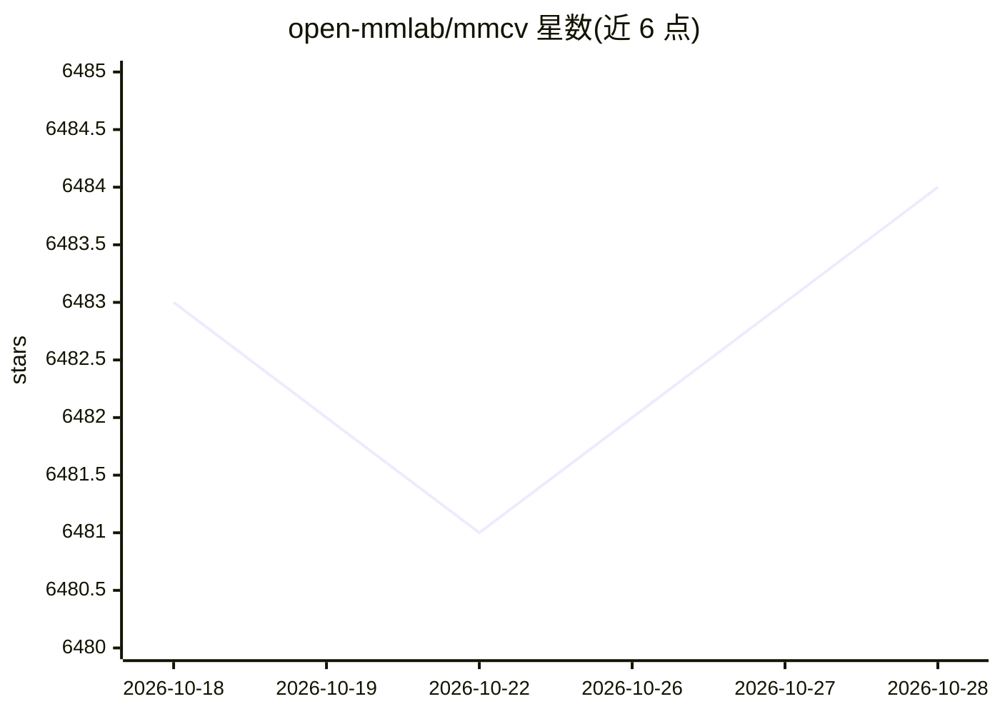

# open-mmlab/mmcv

⭐ 6,483 · Python · Apache-2.0 · 推送 2026-09-28 · [GitHub](https://github.com/open-mmlab/mmcv) · [官网](https://mmcv.readthedocs.io/en/latest/) · 组织维护 · 中文 README

**面向计算机视觉研究的基础库：图像处理、变换与 CPU/CUDA 算子**

OpenMMLab 团队维护的计算机视觉基础库，为 CV 研究与上层工具箱提供图像/视频处理、图像与标注可视化、图像变换、多种 CNN 结构以及常见 CPU/CUDA 算子的实现；支持 Linux/Windows/macOS，要求 Python 3.7+。提供 mmcv（含 CUDA 算子）与 mmcv-lite（无 CUDA 算子）两个版本，经 openmim/pip 安装，部分版本组合需从源码编译。2.x 起移除训练流程相关组件，训练能力由 MMEngine 承接。

## 筛选速览

| 维度 | 判定 | 备注 |
|---|---|---|
| AI 角色 | `ai-ecosystem` | LLM/agent 周边工具 |
| 许可风险 | `permissive` | Apache-2.0 |
| 部署形态 | `library` | 以包/库形式分发 |
| 模型依赖 | — | README 未给出锁定关系 |
| 硬件要求 | — | 无带数字的原话,不猜 |
| 安装摩擦 | `medium` | 含编译或系统依赖之一 |
| 成熟度 | — | 结构信号不足 |

## 能力要点

- 图像/视频处理、图像变换与可视化功能集
- 多种 CNN 结构与高质量 CPU/CUDA 算子实现
- mmcv 与 mmcv-lite 双版本可选（是否含 CUDA 算子）
- 同时维护 1.x 与 2.x 两条版本线

## 适用场景

- 为 OpenMMLab 系工具箱（MMDetection/MMSegmentation 等）提供底层依赖
- CV 研究项目中复用图像变换与 CUDA 算子
- 在 Apple Silicon 上配合 PyTorch 1.13+ 使用（mmcv-lite）

## 场景标签

`图像视频处理` · 领域:感知与多模态

## 证据(README 行号)

> L43: MMCV is a foundational library for computer vision research and it provides the following functionalities:
> L49: - High-quality implementation of common CPU and CUDA ops
> L35: The OpenMMLab team released a new generation of training engine MMEngine at the World Artificial Intelligence Confe

## 星数曲线

2026-10-18 6,483 → 2026-10-28 6,484（+1）

---
*卡片 v1 · prompt 1.4 · 生成 2026-10-20 · 置信度 high · 依据 README sha `428707639fe6` · [字段定义](../../DATASET.md)*
