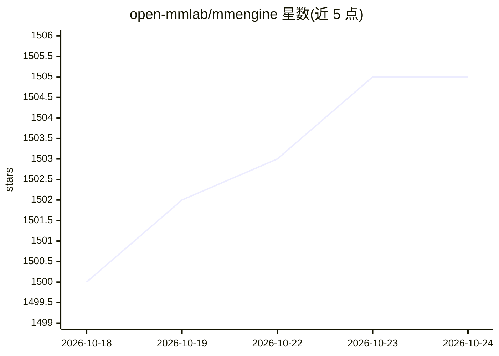

# open-mmlab/mmengine

⭐ 1,505 · Python · Apache-2.0 · 推送 2026-07-13 · [GitHub](https://github.com/open-mmlab/mmengine) · [官网](https://mmengine.readthedocs.io/) · 组织维护 · 中文 README

**基于 PyTorch 的深度学习模型训练基础库**

OpenMMLab 各代码库的统一训练引擎，也可用于非 OpenMMLab 项目。提供 Runner 训练流程编排、BaseModel/BaseDataset/BaseMetric 等抽象基类、纯 Python 风格与 JSON/YAML 文本配置系统；集成 ColossalAI/DeepSpeed/FSDP 大规模训练框架，支持混合精度、梯度累积、梯度检查点等训练策略，并接入 TensorBoard/WandB/MLflow 等监控平台。以 Python 包形式经 pip/mim 安装，需先装 PyTorch。

## 筛选速览

| 维度 | 判定 | 备注 |
|---|---|---|
| AI 角色 | `ai-ecosystem` | LLM/agent 周边工具 |
| 许可风险 | `permissive` | Apache-2.0 |
| 部署形态 | `library` | 以包/库形式分发 |
| 模型依赖 | — | README 未给出锁定关系 |
| 硬件要求 | — | 无带数字的原话,不猜 |
| 安装摩擦 | `low` | 无编译、无系统依赖或容器化 |
| 成熟度 | — | 结构信号不足 |

## 能力要点

- 作为 OpenMMLab 全系代码库的训练引擎，亦可独立用于其他项目
- 集成 ColossalAI/DeepSpeed/FSDP 大规模训练框架
- 混合精度、梯度累积、梯度检查点等训练策略
- 接入 TensorBoard/WandB/MLflow/ClearML 等 7 种训练监控平台

## 适用场景

- 为自研 PyTorch 项目搭建可配置的训练与验证流程
- 用统一引擎运行 OpenMMLab 系列算法库
- 在配置文件中切换大规模训练后端与监控平台

## 场景标签

`模型训练` `MLOps` · 领域:训练与推理

## 证据(README 行号)

> L53: MMEngine is a foundational library for training deep learning models based on PyTorch. It serves as the training en
> L74: - TensorBoard | WandB | MLflow

## 星数曲线

2026-10-18 1,500 → 2026-10-24 1,505（+5）

---
*卡片 v1 · prompt 1.4 · 生成 2026-10-21 · 置信度 high · 依据 README sha `a8938aeaaadc` · [字段定义](../../DATASET.md)*
