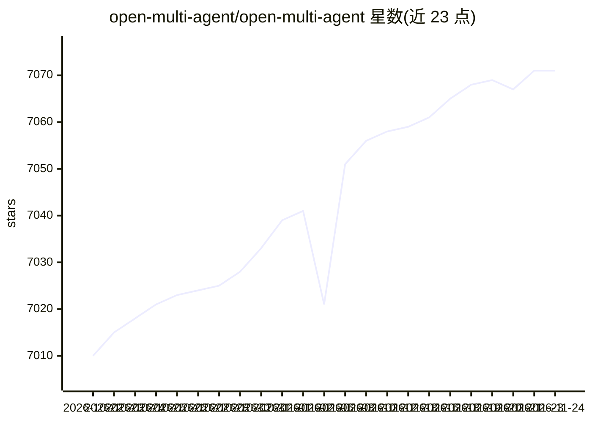

# open-multi-agent/open-multi-agent

⭐ 7,072 · TypeScript · MIT · 推送 2026-11-22 · [GitHub](https://github.com/open-multi-agent/open-multi-agent) · [官网](https://open-multi-agent.com/go/repo) · 组织维护 · 中文 README

**给企业自托管的 TypeScript 多智能体运行时，带审批与可验证运行记录**

OMA 是一个自托管的 TypeScript 智能体运行时库，用于协调多个 agent、插入人工审批门并在离线状态下检查运行记录。核心机制包括：持久化存储下的可恢复审批流程、记录模型输入/工具调用/结果的运行日志与离线一致性校验 verifyRun()、声明角色与执行顺序的治理检查，以及由两次模型调用加确定性调度器组成的可选协调器。MIT 许可，无遥测、无托管控制面，通过 npm 包分发，含 CLI 与离线 Run Viewer。

## 筛选速览

| 维度 | 判定 | 备注 |
|---|---|---|
| AI 角色 | `ai-ecosystem` | LLM/agent 周边工具 |
| 许可风险 | `permissive` | MIT |
| 部署形态 | `self-host` | docker 或自建部署 |
| 模型依赖 | local-ok | 支持本地模型 |
| 硬件要求 | — | 无带数字的原话,不猜 |
| 安装摩擦 | `low` | 无编译、无系统依赖或容器化 |
| 成熟度 | — | 结构信号不足 |

## 能力要点

- 持久化人工审批门：进程重启后可从已审内容继续
- 可验证运行日志：离线校验 run journal 的来源与内容一致性
- 治理底线检查：声明所需角色与执行顺序并核对实际运行
- 无遥测、无托管后端，支持本地模型与 OpenAI 兼容端点

## 适用场景

- 企业内部自托管多智能体系统并保留审计记录
- 在工具调用前插入人工审批环节
- 在离线或本地模型环境下运行智能体编排

## 场景标签

`Agent 框架` `多智能体` · 领域:Agent 开发

## 证据(README 行号)

> L4:  OMA (Open Multi-Agent) is a self-hosted TypeScript agent runtime for coordinating agents, adding human approval gat
> L69: - **Your keys, your models.** Built-in adapters for Anthropic, OpenAI, Azure OpenAI, Bedrock, Gemini, Grok, NVIDIA,

## 星数曲线

2026-10-22 7,010 → 2026-11-24 7,071（+61）

---
*卡片 v1 · prompt 1.4 · 生成 2026-11-23 · 置信度 mid · 依据 README sha `96a976a85d8a` · [字段定义](../../DATASET.md)*
