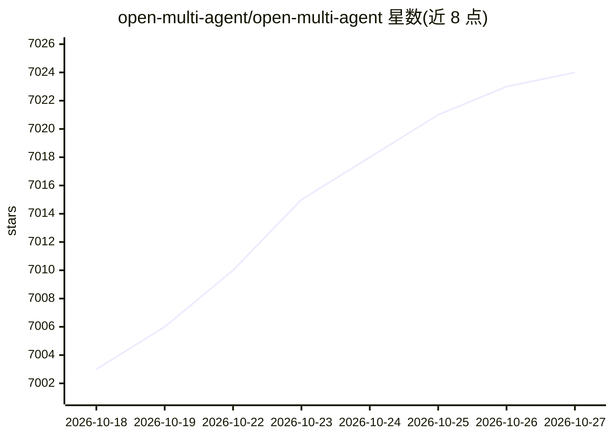

# open-multi-agent/open-multi-agent

⭐ 7,024 · TypeScript · MIT · 推送 2026-10-26 · [GitHub](https://github.com/open-multi-agent/open-multi-agent) · [官网](https://open-multi-agent.com/go/repo) · 组织维护 · 中文 README

**自托管 TypeScript 多 Agent 运行时：审批门与可验证运行记录**

OMA 是以 npm 库形式提供的自托管 TypeScript agent 运行时，支持单 agent（runAgent）、显式流水线（runTasks）与目标规划（runTeam）三种执行模式，内置调度器、检查点、持久化人工审批门、运行日志与离线 Run Viewer。提供 Anthropic/OpenAI/Azure/Bedrock/Gemini 及 DeepSeek、豆包等内置适配器，Ollama/vLLM/llama-server 经 baseURL 接入，可配置 offline/allowlist 出站策略。无遥测、无托管控制面；需 Node.js 20+。MIT 许可，另有可选 OpenTelemetry 适配包与脚手架 create-oma-app。

## 筛选速览

| 维度 | 判定 | 备注 |
|---|---|---|
| AI 角色 | `ai-ecosystem` | LLM/agent 周边工具 |
| 许可风险 | `permissive` | MIT |
| 部署形态 | `self-host` | docker 或自建部署 |
| 模型依赖 | local-ok | 支持本地模型 |
| 硬件要求 | — | 无带数字的原话,不猜 |
| 安装摩擦 | `low` | 无编译、无系统依赖或容器化 |
| 成熟度 | — | 结构信号不足 |

## 能力要点

- 持久化人工审批门：重启后可从已审核内容继续
- 运行日志记录模型输入/工具调用/结果，verifyRun() 离线核验一致性
- 无遥测、无托管控制面，密钥与模型归用户所有
- 离线 Run Viewer 回放任务 DAG 与 span 瀑布图

## 适用场景

- 在自有后端中编排多 agent 流水线并加人工审批
- 对 agent 运行过程做离线审计与治理检查
- 用本地模型（Ollama/vLLM）自托管运行 agent，不经托管控制面

## 场景标签

`Agent 框架` `多智能体` · 领域:Agent 开发

## 证据(README 行号)

> L4:  OMA (Open Multi-Agent) is a self-hosted TypeScript agent runtime for coordinating agents, adding human approval gat
> L52: `runAgent()` runs a single agent, `runTasks()` executes an explicit pipeline, and `runTeam()` plans from a goal. Th

## 星数曲线

2026-10-18 7,003 → 2026-10-27 7,024（+21）

---
*卡片 v1 · prompt 1.4 · 生成 2026-10-20 · 置信度 mid · 依据 README sha `9eaa94ef06dc` · [字段定义](../../DATASET.md)*
