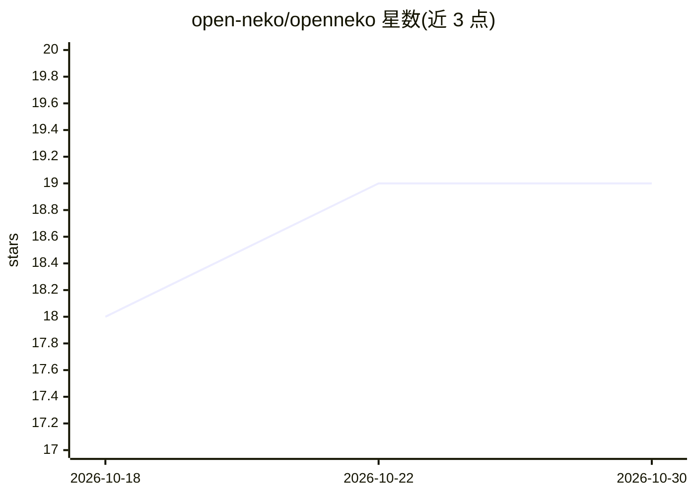

# open-neko/openneko

⭐ 19 · TypeScript · Apache-2.0 · 推送 2026-10-24 · [GitHub](https://github.com/open-neko/openneko) · [官网](https://openneko.app) · 个人维护

**自托管商业运营智能平台：读业务数据、答疑并按规则执行动作**

自托管（Docker + 单一 Postgres）的开源运营智能系统：通过 GraphJin 网关读取 Postgres/MySQL 等数据源，以自然语言描述的 Watcher 定时检查业务指标（如库存低于补货点、订单滞留），生成 Briefing 发现；动作（Slack 告警、Gmail、Sheets、Shopify 写入等）默认起草待人工批准，可按规则自动执行。模型即插即用（Anthropic/OpenAI/Google/Ollama 等），agent 与插件运行于 OpenShell 沙箱，记忆层（发现、规则、决策历史）保留在用户自己的基础设施上。Apache-2.0。

## 筛选速览

| 维度 | 判定 | 备注 |
|---|---|---|
| AI 角色 | `ai-native` | 本体是模型或模型工具 |
| 许可风险 | `permissive` | Apache-2.0 |
| 部署形态 | `self-host` | docker 或自建部署 |
| 模型依赖 | local-ok | 支持本地模型 |
| 硬件要求 | — | 无带数字的原话,不猜 |
| 安装摩擦 | `low` | 无编译、无系统依赖或容器化 |
| 成熟度 | — | 结构信号不足 |

## 能力要点

- 自然语言定义 Watcher 定时检查业务数据并生成 Briefing 发现
- 动作默认 propose-and-approve，可配置规则放行自动执行
- 经 GraphJin 网关接入 Postgres/MySQL 等已有数据源，无需逐连接器开发
- agent 与插件运行在 OpenShell 策略沙箱，密钥不进入模型上下文

## 适用场景

- 我需要让 AI 盯着业务数据，异常时提醒我并起草后续动作
- 我想用自己的 LLM 提供商，自托管一套商业问答与运营代理系统
- 我想在 Slack/Telegram 里对业务数据提问并获得有出处的回答

## 场景标签

`数据分析` `工作流自动化` · 领域:效率与自动化

## 证据(README 行号)

> L9: **OpenNeko watches your business data, flags what's worth a look, and drafts the next action — for you to approve.**
> L41: - **Actions drafted, not auto-fired.** Slack alerts, Gmail follow-ups, Sheets updates, Shopify writes — proposed wi
> L47: OpenNeko reads through **GraphJin**, a GraphQL gateway you point at data you already have:

## 星数曲线

2026-10-18 18 → 2026-10-30 19（+1）

---
*卡片 v1 · prompt 1.4 · 生成 2026-10-28 · 置信度 high · 依据 README sha `5e05d214363a` · [字段定义](../../DATASET.md)*
