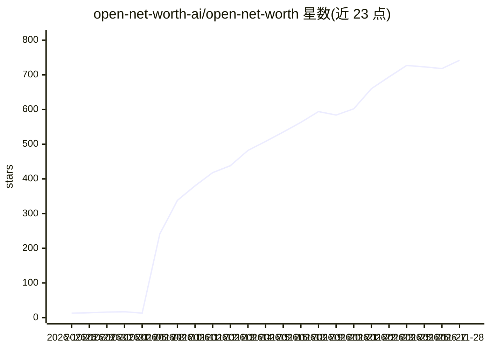

# open-net-worth-ai/open-net-worth

⭐ 742 · Python · AGPL-3.0 · 推送 2026-11-27 · [GitHub](https://github.com/open-net-worth-ai/open-net-worth) · [官网](https://opennetworth.ai) · 组织维护

**自托管个人理财 AI agent：管理预算、投资并可下单交易**

开源（AGPL-3.0）的个人理财 agent harness：多币种账本、零基信封预算、持仓与退休规划构成数据基底，AI 助手 Lucius 通过带权限分级（always_allow/needs_approval/blocked）的工具注册表直接读写账本、整理交易、生成报告，并可经 MCP 连接券商下单（默认需确认）。桌面应用自带 Python，支持 macOS(Apple Silicon)/Windows/Linux 安装包，或源码运行服务器；首次运行必须配置一个 AI 模型。无遥测，数据留在本机。

## 筛选速览

| 维度 | 判定 | 备注 |
|---|---|---|
| AI 角色 | `ai-native` | 本体是模型或模型工具 |
| 许可风险 | `viral` | AGPL-3.0 |
| 部署形态 | `desktop` | 安装包/桌面程序 |
| 模型依赖 | local-ok | 支持本地模型 |
| 硬件要求 | — | 无带数字的原话,不猜 |
| 安装摩擦 | `low` | 无编译、无系统依赖或容器化 |
| 成熟度 | — | 结构信号不足 |

## 能力要点

- AI agent 经权限分级工具直接读写账本，写操作默认需确认卡片
- 支持信封预算、多币种账本、持仓与退休概率规划
- 可接入 MCP server 扩展工具（含券商下单、Telegram、邮件）
- API key、Claude Code/Codex 登录或 Ollama 本地模型均可驱动

## 适用场景

- 自托管管理个人预算、账本与投资组合
- 让 AI agent 按计划自动记账、对账并生成每日简报
- 通过 MCP 连接券商在确认后执行交易
- 从 YNAB 等托管理财应用迁移到本地数据

## 场景标签

`AI 助手` `金融量化` · 领域:对话与助手

## 证据(README 行号)

> L28: **An open-source agent harness for personal finance.** A real multi-currency ledger, budgets, and
> L29: investments — plus an AI that can actually read and change them, not just talk about them.
> L98: |**Lucius**|The AI agent on every screen. He works your real book through real tools: logs and sorts transactions, 

## 星数曲线

2026-10-26 13 → 2026-11-28 742（+729）

---
*卡片 v1 · prompt 1.4 · 生成 2026-11-24 · 置信度 high · 依据 README sha `896ab5bdce2c` · [字段定义](../../DATASET.md)*
