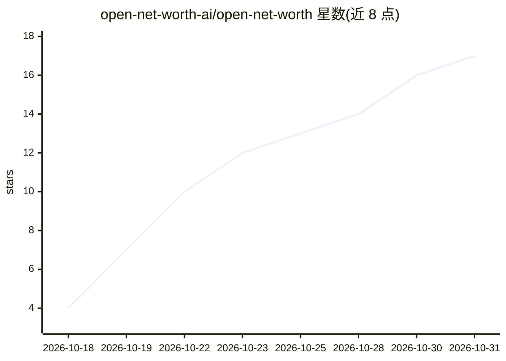

# open-net-worth-ai/open-net-worth

⭐ 17 · Python · AGPL-3.0 · 推送 2026-10-30 · [GitHub](https://github.com/open-net-worth-ai/open-net-worth) · [官网](https://opennetworth.ai) · 组织维护

**自托管个人记账/预算/投资应用，AI Agent 通过工具直接操作账本**

本地优先的个人财务应用：多币种账本、零基信封预算、投资持仓与退休规划，配一个名为 Lucius 的 AI agent，通过受权限控制的工具集（always_allow/needs_approval/blocked）直接读写账本，执行对账、交易分类、定时任务等操作；支持连接 MCP 服务器扩展工具，接入 SimpleFIN/Plaid 等银行券商连接器。AI 模型需自带 API key（Anthropic/OpenAI/OpenAI 兼容端点）或 Ollama 本地模型，首次运行无跳过选项。提供桌面安装包（macOS Apple Silicon/Windows/Linux x86_64）、服务器与 Docker 三种部署方式；不支持多用户/家庭账户与移动端。

## 筛选速览

| 维度 | 判定 | 备注 |
|---|---|---|
| AI 角色 | `ai-native` | 本体是模型或模型工具 |
| 许可风险 | `viral` | AGPL-3.0 |
| 部署形态 | `desktop` | 安装包/桌面程序 |
| 模型依赖 | local-ok | 支持本地模型 |
| 硬件要求 | — | 无带数字的原话,不猜 |
| 安装摩擦 | `low` | 无编译、无系统依赖或容器化 |
| 成熟度 | — | 结构信号不足 |

## 能力要点

- AI agent 通过带权限级别的工具集直接操作账本，写操作前展示确认卡
- 支持 MCP 服务器扩展工具与银行/券商同步连接器（SimpleFIN、Plaid、Interactive Brokers 等）
- 本地优先：数据存于 ~/.open-net-worth/，无遥测，除自行配置的调用外不出机器
- 桌面安装包/服务器/Docker 三种部署，自动备份与一键恢复

## 适用场景

- 在自己机器上自托管记账、预算与投资追踪，不依赖云服务
- 让 AI agent 代为分类交易、对账账户、生成日报周报
- 从 YNAB 或 Lunch Money 迁移交易数据继续使用信封预算法

## 场景标签

 · 领域:个人理财/桌面与自托管应用

## 证据(README 行号)

> L24: **An open-source agent harness for personal finance.** A real multi-currency ledger, budgets, and
> L30: assistant (Lucius) is an agent operating them through a registry of real tools — the same guarded
> L56: |**Lucius**|The AI agent on every screen. He works your real book through real tools: logs and sorts transactions, 

## 星数曲线

2026-10-18 4 → 2026-10-31 17（+13）

---
*卡片 v1 · prompt 1.4 · 生成 2026-10-30 · 置信度 high · 依据 README sha `7fd2aefeeceb` · [字段定义](../../DATASET.md)*
