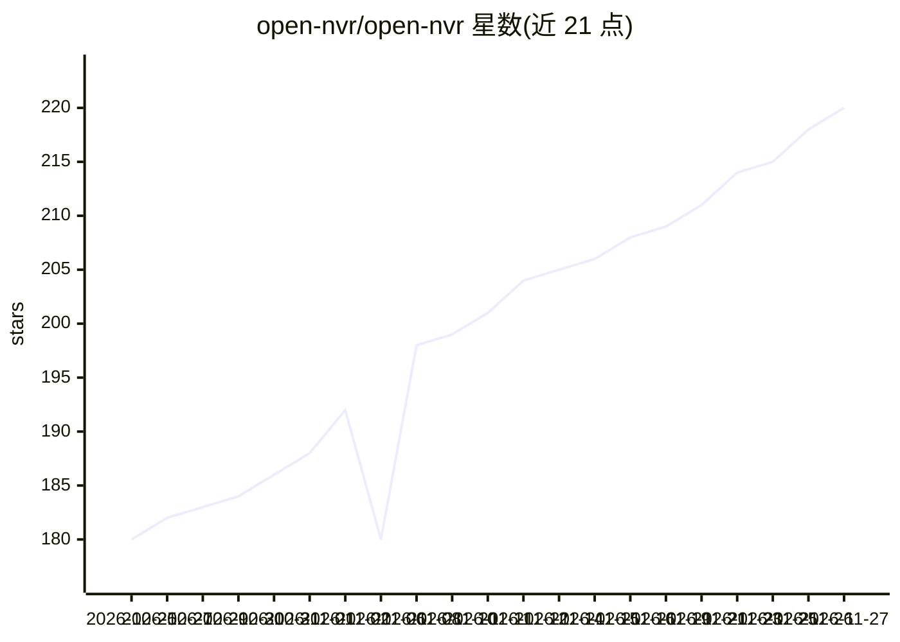

# open-nvr/open-nvr

⭐ 220 · Python · AGPL-3.0 · 推送 2026-11-26 · [GitHub](https://github.com/open-nvr/open-nvr) · [官网](https://opennvr.org) · 组织维护

**自托管 NVR 平台：在自己的摄像头硬件上运行任意 AI 模型**

开源视频基础设施：接入 ONVIF/RTSP 摄像头进行录制、直播（WebRTC），通过一份公开契约将任意 AI 模型（检测、车牌、人脸、VLM、语音）挂到摄像头流后面，其上提供 14 个可安装应用（入侵、越线、门铃、语音 agent 等）。面向不能把摄像头交给厂商的组织，默认本地运行、可气隙部署，模型权重以 SHA-256 指纹逐分钟复核并全程审计。Docker 两步部署，App SDK 与 Adapter SDK 以 Apache-2.0 发布于 PyPI。

## 筛选速览

| 维度 | 判定 | 备注 |
|---|---|---|
| AI 角色 | `ai-native` | 本体是模型或模型工具 |
| 许可风险 | `dual` | AGPL-3.0 |
| 部署形态 | `self-host` | docker 或自建部署 |
| 模型依赖 | local-ok | 支持本地模型 |
| 硬件要求 | — | 无带数字的原话,不猜 |
| 安装摩擦 | `low` | 无编译、无系统依赖或容器化 |
| 成熟度 | — | 结构信号不足 |

## 能力要点

- 统一模型契约：检测器/车牌/VLM 等模型可热插拔替换，其余不变
- 模型权重 SHA-256 指纹、逐分钟复核与 correlation id 审计链路
- 默认拒绝的离线门（DEPLOYMENT_MODE=offline / AI_SOVEREIGNTY=local_only）与双 NIC 摄像网隔离
- 两个 Apache-2.0 SDK（opennvr-app-sdk / opennvr-adapter-sdk）发布于 PyPI

## 适用场景

- 在气隙或内网环境自建摄像头 AI 分析，不让画面出网
- 在既有硬件上通过换模型新增车牌、人脸等能力
- 通过 MQTT discovery 与 Home Assistant 集成联动家庭自动化
- 为自己的模型编写 adapter，接入平台的事件与审计体系

## 场景标签

`目标检测` · 领域:感知与多模态

## 证据(README 行号)

> L7: OpenNVR is open-source video infrastructure for organisations and people who cannot hand their cameras to a vendor. 
> L115: |🧠|**An AI platform for cameras**|Any model behind a REST or WebSocket endpoint becomes a capability through a pub
> L42: ### 🧠 Any AI model

## 星数曲线

2026-10-25 180 → 2026-11-27 220（+40）

---
*卡片 v1 · prompt 1.4 · 生成 2026-11-26 · 置信度 high · 依据 README sha `ba86d475e568` · [字段定义](../../DATASET.md)*
